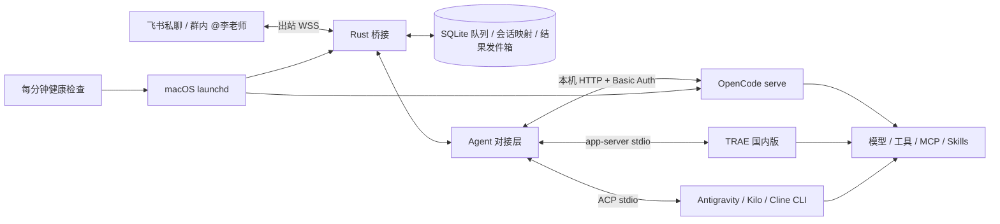

# 李老师（mr-li）

一个 Rust 常驻桥接服务：通过飞书接收消息，把执行交给可选的 Agent，再把结果和补充提问发回飞书。OpenCode 是默认后端，另支持 Antigravity CLI、Kilo CLI、TRAE 国内版和 Cline CLI。



## Agent 选择与对接

在飞书输入 `/model`，打开统一的 Agent 和模型选择卡片。下拉选项直接显示“Agent · Model”，点一次同时切换两项；`/agent` 和 `/models` 作为兼容入口打开相同卡片。OpenCode 列出实时免费模型，Cline 列出官方免费目录并支持自动选择；Kilo 使用 Auto Free，Antigravity 使用 Gemini 3.8 Flash，TRAE 使用免费账户默认模型。模型目录暂不可用时仍可选择各 Agent 的默认入口，实际执行时继续检查免费模型和账号权限。选择按工作目录、用户和聊天保存，不同话题共用选择；各 Agent 的模型偏好和会话分别保留，跨重启保存。当前聊天有模型任务执行时先 `/stop` 再切换；排队任务使用执行开始时的选择。`/new` 只清除当前 Agent 的会话映射。

Kilo 首次启动在繁忙的 Mac mini 上可能超过 30 秒，桥接为其协议初始化保留最多 90 秒；后续控制请求仍为 30 秒。启动失败提示包含等待上限，避免误判为设备工具未接入。Kilo 通过 ACP 加载设备工具，无需使用 Cline 的专用配置兼容入口。

| Agent | 官方调用入口 | 运行方式 | 免费用量策略 |
| --- | --- | --- | --- |
| OpenCode | 原生 HTTP V2.3 | 独立 `opencode serve` | 保留现有官方免费模型目录检查 |
| Antigravity CLI | `agy acp` | 常驻 stdio JSON-RPC，事件推送 | Google 个人账号 OAuth，固定免费档 Gemini 3.8 Flash，不用模型 API Key |
| Kilo CLI | `kilo acp` | 常驻 stdio JSON-RPC，事件推送 | 固定 Auto Free；后台标题、摘要等内置 Agent 也固定免费模型 |
| TRAE 国内版 | `traecli app-server --listen stdio://` | 原生 app-server，常驻 stdio JSON-RPC，事件推送 | 检查国内 TRAE 登录身份，使用账号积分；不使用 API Key 或其他账号提供方 |
| Cline CLI | `cline --acp` | 常驻 stdio JSON-RPC，事件推送 | 优先选择官方免费目录与 CLI 列表交集；ACP 漏列时使用官方目录中的 cline-free/* 专用免费入口，每次任务前重新核实 |

这些是支持常驻和推送的官方接口选择，没有对各协议做性能排名。复用进程可以省去逐次启动 CLI 的等待，三个 ACP 后端不轮询结果。OpenCode 适配器继续保留现有 HTTP 轮询。每个外部 Agent 会话使用独立进程，最多保留 8 个空闲/运行中的会话进程；空闲进程被回收后，通过官方会话恢复接口重连。CLI 若不支持恢复，会提示 `/new`，不会悄悄丢弃上下文或重放旧任务。

Gemini CLI 已于 2026-06-18 停止服务个人免费、Pro 和 Ultra 账号，Google 后端使用官方后继 Antigravity CLI（个人免费档每周刷新额度）。旧 `gemini` 选择标识兼容映射到 Antigravity；旧 Gemini 会话不能迁移。参见[官方迁移公告](https://github.com/google-gemini/gemini-cli/discussions/27274)和[免费档说明](https://antigravity.google/pricing)。

部署时先安装并登录所需 CLI，再配置 `.env` 的 `MR_LI_ANTIGRAVITY_BIN`、`MR_LI_KILO_BIN`、`MR_LI_TRAE_BIN`、`MR_LI_CLINE_BIN`（可以用绝对路径）。Antigravity 用 `agy acp --login` 登录 Google 个人账号；TRAE 用支持 app-server 的 CLI 2.0 运行 `traecli login`；Cline 用 `cline auth` 登录 Cline，并选 Cline 账户提供方；Kilo Auto Free 可按其账号规则使用，需登录时用 `kilo auth login`。服务不会从开发机复制凭证。`mr-li agents` 只检查程序路径并显示协议，不调用模型、不代表登录或额度已验证。

TRAE IDE 免费积分不等于 CLI/app-server 权限：当前官方 CLI 文档仍限制企业旗舰版，实际国内免费账号是否有权限需要登录后确认。旧的 TRAE CLI 0.120.13 没有 app-server，不能使用此适配器。运行失败会在飞书提示，保持所选 Agent，不切到其他后端或付费模型。Antigravity/TRAE 的额度由所登录账号控制；本服务不自动充值、不代领签到积分，也不能从协议中保证账号是免费套餐。Cline 免费模型促销结束或目录不可用时会停止，而不使用付费模型。

`/model` 同时管理 Agent 和模型。`/status` 显示当前 Agent 与模型选择；其他 Agent 的 `/skills`、`/mcp` 暂返回配置说明，避免误展示 OpenCode 的目录。平板启用后，ACP 会话创建/恢复时传入本机 homework MCP，TRAE 使用 thread 配置覆盖；OpenCode 保留原有自动注册流程。TRAE 的结构化补充提问复用飞书表单卡片；ACP 普通补充提问作为文字回答展示，用户可继续回复。

外部 CLI 不继承飞书密钥或模型 API Key，保留用户网络代理设置。`/stop`、超时及协议断开会终止所属进程组并等待确认；独立 worker 在桥接崩溃导致 stdin 关闭时清理 CLI 和工具子进程。重启不自动重跑中断任务。推理和工具输出不转发到飞书。

验证：真实 CLI 握手通过：Antigravity 1.5.12、Kilo 7.8.27、TRAE 0.216.0、Cline 3.0.74。Kilo 另外验证了无登录创建会话和选择 Auto Free，已通过真实模型请求，返回 OK。Antigravity 1.5.12 已在 Mac mini（macOS 12 / Intel）完成个人账号登录和 ACP 验证。协议测试覆盖事件流、会话恢复、补充提问、停止/超时和免费额度错误，卡片测试覆盖用户/聊天/消息绑定及持久化选择。原 Agent 层已部署到 Mac mini；Antigravity 后继适配尚待部署。Antigravity 账号已登录，但首次实际模型请求返回许可证错误 #3501，尚不能使用；飞书实机卡片尚待验证。

```sh
cargo test --bin mr-li
cargo clippy --bin mr-li --tests -- -D warnings
cargo build --bin mr-li
python3 scripts/test-watchdog.py
python3 scripts/smoke-agents.py target/debug/mr-li
# 可选：用临时 HOME/XDG 验证真实 CLI 握手，不登录、不调用模型
python3 scripts/smoke-agents.py target/debug/mr-li --cli trae /absolute/path/to/traecli
```

协议参考：[Antigravity ACP](https://antigravity.google/docs/cli/acp/)、[Kilo CLI](https://kilo.ai/docs/code-with-ai/platforms/cli-reference)、[TRAE 命令行](https://docs.trae.cn/cli_command-line-parameters)、[Cline ACP](https://docs.cline.bot/usage/acp)、[Cline 免费模型](https://docs.cline.bot/getting-started/free-models)。

## 为什么使用 HTTP，而不先接 ACP

OpenCode 自身提供 `opencode serve`，可以通过 HTTP 创建会话、提交任务、中止任务和处理权限/提问。桥接层用 `reqwest` 直接调用这些接口，无需额外的 JS SDK、Node、ACP JSON-RPC 客户端或终端模拟。ACP 用于兼容其他 Agent；OpenCode 适配器直接使用原生 HTTP；其他后端通过上文的 Agent 对接层接入。`opencode run --format json` 也可做一次性调用，但长期桥接还需要自行处理子进程、会话、授权和提问，因此当前选择常驻 HTTP 服务。

**OpenCode 适配器只接入 V2.3.x，已验证 macOS 12 兼容版 2.3.0**。使用 `/api/info`、`/api/model`、`/api/session` 等 V2 接口，不再运行独立的 V1。macOS 12 必须保留可运行的兼容启动器及其底层包，不能用普通官方二进制覆盖。

参考：[V2 API](https://opencode.ai/docs/api)、[飞书官方长连接实现](https://github.com/larksuite/oapi-sdk-python/blob/v2_main/lark_oapi/ws/client.py)。

## 当前支持

- 飞书企业自建应用 WebSocket：发现地址、Protobuf 帧、心跳、分片重组、ACK、断线退避重连；不需要公网端口。
- 应用 ID 默认 `cli_aa9b39cf2f789eef`，Secret 从部署机的 `.env` 读取。
- 支持飞书和 Lark 国际版（`FEISHU_DOMAIN=feishu` / `lark`）；可通过 `FEISHU_ALLOWED_CHAT_IDS` 限定群 ID；私聊仅校验 `FEISHU_ALLOWED_OPEN_IDS` 用户白名单，无需另加会话 ID。
- 用户 open_id 白名单；私聊直接接收，群聊必须 @当前机器人；过滤机器人消息。支持文字、独立图片、富文本图文消息和模型选择卡片；引用图片回复文字时会读取原图（含升级前收到的图片）。图片随请求传给 OpenCode V2 / ACP Agent，识图需要模型本身支持视觉；TRAE 后端暂不支持图片，会明确报错。单次最多 8 张，每张最多 10MB，支持 PNG/JPEG/GIF/WebP。下载失败会报错，不会仅发送文字继续执行。文件和音频尚未接入。飞书应用需要消息读取及消息资源读取权限。
- 私聊按用户和聊天保留会话；群聊再按话题根消息隔离。不同用户不共享 OpenCode 会话，但共用配置的工作目录和文件。
- 默认全局只执行 **1 个模型任务**，其他消息进持久队列（上限 500）；指令和授权回复仍可处理。单线程 Tokio，避免为桥接创建大量工作线程。
- 消息先落 SQLite 再 ACK；按 message_id 去重（完成记录保留 30 天）。回复分片并记录进度，失败指数退避重试；UUID 减少飞书重试产生的重复回复。跨平台/跨进程不承诺端到端 exactly-once。
- 重启保留会话、未执行任务和结果发件箱；执行中的任务先请求中止并提示，不自动重跑。操作可能已发生，用户检查后再决定是否重发。
- `/model` 或“切换模型”打开统一交互卡片：下拉点选“Agent · Model”，原子保存两项选择。卡片只允许发起者在原聊天操作，回调幂等处理；提交时重新验证显式免费模型是否仍然免费。
- `/approve` 只批准一次，并核对请求是否属于当前用户/聊天/话题对应的会话。不会自动批准所有工具。
- OpenCode 默认使用独立直连进程：清除该进程继承的大小写 HTTP/HTTPS/ALL_PROXY，设置 NO_PROXY=*；不修改系统代理。`MR_LI_DIRECT_NETWORK=false` 可显式恢复继承网络环境。桥接访问本机 OpenCode API 始终不走代理。
- 上游 429 只表示免费请求被限流或拒绝，不能直接当成账号额度耗尽；代理出口和不兼容的内核也可能触发拒绝。
- 任务默认 30 分钟超时并请求中止；同一数据目录只允许一个桥接进程。
- `launchd` 分别保护两个进程，退出后自动重启；独立 watchdog 检测 OpenCode HTTP 失联和桥接心跳停滞。

Rust 降低的是桥接进程的内存和启动开销。OpenCode、模型、MCP 与工具仍有各自开销；低配置机器建议使用远程模型，少开 MCP 服务。当前没有实测整机内存占用或模型任务延迟。

处理反馈沿用 `xiaoli/server` 的飞书逻辑：普通模型任务及用户发送的所有 Slash 命令（包括 `/speak`、`/photo`、`/video`）开始执行时，随机在原消息添加 `Typing`、`OnIt`、`THINKING`、`OneSecond` 之一，回复全部送达后撤除。错误与停止结果回发后同样清理；表情记录持久保存，重启后继续清理，撤除失败每 30 秒重试。表情接口故障不阻止任务执行；需要 `im:message` 或 `im:message.reactions:write_only` 权限。卡片回调、后台采样和内部语音任务不向原消息重复添加表情。快速命令的处理表情可能只短暂显示。

## 开发与验证

需要 Rust 1.88+、C 编译工具（macOS Command Line Tools）。SQLite 静态编译，不需要独立数据库服务。

```bash
cargo test --locked
cargo clippy --locked --all-targets -- -D warnings
./scripts/build-release.sh
```

产物：`dist/mr-li-Darwin-<架构>.tar.gz`，包括 Rust 二进制、脚本、示例配置和说明，不打包密钥/数据，也不打包 OpenCode。**编译产物架构应匹配目标机**；本机 Intel 编译的包不能当成 Apple Silicon 原生包。可在同架构机器构建，或把源码搬到目标 Mac mini 构建一次。

可选的真实 OpenCode 接口冒烟检查（仅开发测试需要 Python 3）：

```bash
python3 scripts/smoke-opencode.py /absolute/path/to/opencode
```

这个检查保留兼容启动器所需的 HOME，使用临时 XDG、数据库和工作目录，不连接飞书、不提交模型任务、不触碰日常 OpenCode 会话。它验证真实 V2 的健康、鉴权、会话、权限/表单和配置接口。

## GitHub 与本机自动部署

在目标 Mac mini 的**现有服务目录**安装检查任务，不要在开发机安装：

```bash
python3 scripts/auto-deploy.py install --repo https://github.com/mnhkahn/mr-li.git --branch main
```

默认服务域是 `user/<uid>`，适用于上面的无人登录启动方案。登录型 LaunchAgent 传 `--domain gui/$(id -u)`；系统服务需要有权重启 system 域的部署机制，此脚本不申请管理员权限。自定义 `MR_LI_DATA_DIR` 时，安装命令同时传 `--data-dir /实际数据目录`。需 Python 3、Git、Rust 1.88+、支持自动选择工具链的 Go 及 Command Line Tools；这些工具应提前安装，后台任务不弹窗、不交互登录。私有仓库需事先为部署用户配置 Git 只读凭据。需要每次一起更新坐姿二进制时加 `--pose`，否则保留现有坐姿二进制和模型。

安装后每分钟检查一次 `main`，不依赖其他电脑在线或桌面登录。GitHub 新提交会拉到独立的 `.data/auto-deploy/source`，测试、构建成功后才替换部署文件，重启 OpenCode 与 bridge。Git 提交号相同就跳过构建和重启；不会仅比较一直未变的 `Cargo.toml` 版本。GitHub 落后于已部署的本机提交或历史分叉时跳过，避免覆盖现场新代码；请把本机提交推送到配置分支后再继续自动更新。尚未提交的现场改动需提交、推送后才能长期保留在后续 GitHub 版本中。

人在电脑旁时仍可本机构建 `./scripts/build-release.sh`。发布包现在含 `release.json`（提交号、工作区是否有改动、内容哈希）。把**完整解压目录**复制到目标机 `.data/auto-deploy/incoming.tmp`，复制结束后重命名为 `incoming`，下一次检查会优先部署它。不要复制到正在运行的 `bin/` 后再生成版本文件。相同内容版本跳过部署和重启。也可立即应用一个完整包：

```bash
python3 scripts/auto-deploy.py once --package /绝对路径/mr-li-Darwin-x86_64
python3 scripts/auto-deploy.py status
```

并发检查共用文件锁；安装、手动应用均使用同一份版本记录。部署前核对完整包的哈希并检查配置，部署后等待新进程心跳及 OpenCode 健康检查；90 秒内不健康则恢复本次替换的旧文件并重启。回滚不撤销新进程可能产生的数据写入。`.env`、会话数据库、凭据及可选模型不会被发布包清空。第一次安装没有可信版本记录时会部署一次；只有健康检查通过才记录版本，失败后保留旧版本并在下次检查重试。重启会打断正在执行的任务，请在可接受的时间推送发布代码。

配置与版本记录在 `.data/auto-deploy/`，日志在 `logs/auto-deploy.log`。安装任务保留并备份原 crontab；停用时在 `crontab -e` 删除标有 `# MR-LI AUTO-DEPLOY` 的一行。验证脚本：`python3 scripts/test-auto-deploy.py`。

每次确认 GitHub 有可升级的新提交后，先使用现有 `/speak` 的音色和喇叭播报“开始升级”，随后开始测试和编译。播报失败会写入日志，构建继续。每次实际升级且健康检查通过后，播报“升级成功”及本次提交的简短说明，最多列出三项更新。GitHub 升级读取两次部署之间的提交标题；本机包携带最近的提交说明，也可在构建时设置 `MR_LI_RELEASE_NOTES='本次更新内容'`。新提交或本机包内容相同时，播报“程序内容与当前版本相同，本次已跳过升级。”，不重启服务。同一 Git 提交保持静音。失败或回滚时不播报成功。升级结果的播报状态保存在 `.data/auto-deploy/last-announcement.json`。

### 用 GitHub Actions 通知 Mac mini

`main` 推送时，公开仓库的工作流会请求私有仓库排一个部署任务。Mac mini 上的自托管 Runner 通过出站 HTTPS 领到任务后，调用现有部署脚本。脚本仍从 `mr-li` 的 `main` 获取最新版本，并在 Mac mini 上完成构建和部署。

1. 准备一个专用私有仓库，默认分支设为 `main`。把 [部署工作流模板](scripts/deploy-mr-li.workflow.yml) 保存为该仓库的 `.github/workflows/deploy-mr-li.yml`，设置 Actions 变量 `MR_LI_DEPLOY_ROOT` 为 Mac mini 服务目录的绝对路径。
2. 在 Mac mini 上用服务账号注册该私有仓库的 Intel macOS Runner，加标签 `mr-li-deploy`，按 [GitHub 指南](https://docs.github.com/en/actions/how-tos/manage-runners/self-hosted-runners/add-runners) 持久运行。从私有仓库手动触发一次，确认 Runner 可以执行 `once --github-only`。首次迁移可先让旧 cron 部署包含该选项的版本。
3. 在公开仓库设置 Actions 变量 `MR_LI_DEPLOY_REPO`（`所有者/私有仓库名`）和密钥 `MR_LI_DEPLOY_TOKEN`。使用仅授权该私有仓库、拥有 `Actions: write` 权限的细粒度令牌。公开仓库的 **Notify Mac mini deployment** 工作流也支持在 `main` 上手动运行，便于验证转发或补跑。
4. 确认端到端触发后，在 Mac mini 以原安装参数重新运行 `python3 scripts/auto-deploy.py install --runner`，保留原先的 `--domain`、`--data-dir`、`--pose` 等设置。此模式的 cron 只查本地 `incoming` 包。Runner 任务等到部署锁空闲后才读取 GitHub，Actions 页面和本机 `logs/auto-deploy.log` 都可查看执行结果。

## Mac mini 首次部署

以下命令**在目标 Mac mini 执行**。开发电脑无需安装守护服务。

1. 解压构建包到固定目录，例如 `~/Services/mr-li`；或克隆完整源码。
2. 在**目标机的部署用户**下运行交互向导，不要 sudo 整个向导：

```bash
cd ~/Services/mr-li
./scripts/init.sh
```

向导会依次完成：

- 检查本机架构。有可用二进制就跳过编译环境；源码部署时检查 Apple Command Line Tools 和 Rust 1.88+，询问是否安装缺少的工具，再执行 `cargo build --locked --release`。Command Line Tools 的系统窗口安装完成后需重新运行向导。
- 隐藏输入飞书 App Secret；输入允许的用户 open_id、工作目录和模型名称；本地 OpenCode 服务密码可隐藏输入，也可回车生成随机密码。
- 检查 OpenCode V2.3.x 启动器路径。macOS 12 请选择已安装并验证过的兼容启动器；不自动下载替换内核，不安装 V1。
- 生成权限为 600 的 `.env`，创建工作目录；已有 `.env` 默认保留，已有工作目录 OpenCode 配置也保留。
- 默认使用 OpenCode 官方免费模型，任务前检查模型的输入和输出价格为零；免费额度不足或模型下线时返回错误，不自动切到付费模型。会话只提交到所选免费模型，使用显式会话标题，无需迁移开发机的账号配置。
- 最后选择开机运行、登录后运行或暂不安装服务。选择安装才会启动实际服务。

如只想填写配置，不下载、不编译、不认证或启动服务：

```bash
./scripts/init.sh --configure-only
```

也可以手动准备：复制 `.env.example` 为 `.env`，按注释填写，并将 `opencode.example.json` 复制到任务工作目录。OpenCode V2 的安装请参见[官方文档](https://opencode.ai/docs/)，macOS 12 需额外准备兼容包；[Rust 安装说明](https://rust-lang.org/install)提供 rustup 的官方流程。

示例 OpenCode 权限默认全部允许，适合本项目无人值守执行；桥接也会自动同意当前任务所属会话里挂起的操作权限请求，不再发送授权按钮或等待 `/approve`。可按实际需求在工作目录 `opencode.json` 中调整；配置使用 V2 的 `permissions` 规则数组和 `action/resource/effect` 字段。真正需要用户补充信息的提问使用飞书交互卡片，保留 `/answer` 和 `/deny` 作为备用命令。

OpenCode 返回与飞书展示对应关系（[官方 Form/API 定义](https://opencode.ai/docs/api)）：

| 返回内容 | 飞书展示 / 操作 |
| --- | --- |
| 普通文本、Markdown、完成、失败、限流、中断 | Markdown 结果卡片；长内容分卡发送 |
| `string` 无选项 | 文本输入框（邮件、URL、日期等格式沿用上游校验） |
| `string` 带 `options` | 单选下拉，提交选项 `value`；`custom: true` 时另有自定义输入 |
| `multiselect` | 多选下拉；允许自定义时可每行填一项 |
| `boolean` | 是 / 否选择，转成真正布尔值 |
| `number` / `integer` | 数字输入，校验类型及上下限 |
| `external` | 打开 HTTP(S) 链接，完成后点继续；不伪造外部操作结果 |
| 操作权限请求 | 按现有无人值守策略自动允许，仅处理当前任务所属会话 |

表单逐项确认，按 `hidden` / `when` 条件决定后续字段，最后展示答案供核对并统一提交。支持默认值、可选项跳过、重新填写和取消；提交失败留在卡片内显示错误，格式/正则等约束由 OpenCode 最终校验。卡片状态及回调持久化到 SQLite；回调绑定用户、聊天、原卡片和会话，过期版本及重复点击不会重复提交。已处理、取消或失效的表单自动关闭操作入口。推理内容不转发到飞书。


`MR_LI_WORKSPACE` 指向 Agent 的任务目录；请与服务安装目录分开。`.env` 使用 dotenv 语法，路径含空格时用引号；不要用 shell 表达式、`~` 或 `$HOME`，填写绝对路径。环境变量优先于 `.env`。

3. 在 [飞书应用后台](https://open.feishu.cn/app/cli_aa9b39cf2f789eef) 配置：

   - 启用机器人能力，配置应用可用范围。
   - 开通接收单聊消息 `im:message.p2p_msg:readonly`、接收群聊 @机器人消息 `im:message.group_at_msg:readonly`、以应用发送消息 `im:message:send_as_bot` 权限。
   - 事件与回调选择**使用长连接接收事件**，订阅 `im.message.receive_v1`，并发布生效版本。
   - 在独立的“回调配置”页选择**使用长连接接收回调**，订阅新版 `card.action.trigger`，用于模型选择和 OpenCode 提问卡片；不要选择旧版 `_v1`。消息事件订阅与卡片回调订阅需要分别配置。
   - 白名单填用户在这个应用下的 `open_id`（`ou_...`），不是 user_id、union_id 或邮箱。可以通过飞书 API 调试台查询。
   - 同一应用不要在多台机器同时运行此桥接；飞书多连接会分配事件，而不是广播全部消息。

4. 如果向导中暂不安装服务，可先前台检查，两个终端分别执行：

```bash
./scripts/run.sh check
./scripts/run.sh opencode
# 另一个终端：
./scripts/run.sh health
./scripts/run.sh bridge
```

`check` 仅验证本地配置。确认飞书收发、一次模型任务和一次权限请求后，退出前台两个进程，再安装常驻服务。

## 开机运行与进程保护

没有管理员权限、又需要无人登录也运行时，可使用 cron 开机加载后台 launchd 服务：

```bash
bash ./scripts/boot-start.sh install
crontab -l
./scripts/run.sh probe
launchctl print user/$(id -u)/com.cyeam.mr-li.bridge
```

此方式会安装 `@reboot` 启动项，并每分钟补查漏启动的 OpenCode、桥接和 watchdog。实际进程运行在 `user/<uid>` 的 Background 会话，由 launchd 的 KeepAlive 保护，不依赖图形桌面登录。旧的登录型 LaunchAgents 与原 crontab 会备份到 `.data/boot-launchd/backup-<时间>/`，已有的其他 cron 任务保留。watchdog 每分钟检查 OpenCode 健康与桥接心跳，日志保留在原目录，开机加载日志为 `logs/boot-start.log`。不要与下面两种安装方式同时使用。2026-11-17 已在 Mac mini 无桌面登录状态安装并验证后台启动；整机重启后的恢复仍需实际观察。

推荐需要无人登录也运行的 Mac mini 使用系统模式：

```bash
sudo ./scripts/service.sh install system
sudo ./scripts/service.sh status system
sudo ./scripts/service.sh restart system
# 停止并移出 launchd 加载目录，保留配置/日志/会话数据：
sudo ./scripts/service.sh uninstall system
```

请从**实际部署用户**运行 sudo。桥接与 OpenCode 通过 LaunchDaemon 的 `UserName` 以这个用户运行，使用其 HOME，不以 root 执行 Agent。仅系统 watchdog 的固定包装脚本安装为 root 所有；它始终先降权再检查用户服务，再以 root 请求 launchd 重启。

不需要登录前运行时，可以用用户模式，**无需 sudo**：

```bash
./scripts/service.sh install
./scripts/service.sh status
./scripts/service.sh restart
./scripts/service.sh uninstall
```

用户模式是 LaunchAgent，登录后启动，退出登录停止。系统和用户模式择一安装；更换模式前先卸载旧模式。`install` 会重新生成并加载 plist，升级二进制后用 `restart`。服务安装路径或部署用户变化后重新执行 `install`。

两个服务均配置 `KeepAlive`，重启节流 15 秒。watchdog 每 60 秒检查，OpenCode 连续 3 次健康失败触发重启；用户模式下桥接心跳超过 180 秒重启桥接，系统模式下 OpenCode HTTP 与桥接心跳分别计数，连续 3 次失败只重启对应服务。桥接探针不依赖 OpenCode HTTP，以免 OpenCode 单独故障打断其他 Agent。故障检测不是即时的。重启 OpenCode 会中断正在执行的任务。launchd 无法让睡眠中的电脑继续工作；需要常驻时，在系统设置中调整睡眠和断电恢复。FileVault 下整机重启仍可能需要先解锁磁盘。

日志位于安装目录 `logs/`；SQLite 和心跳位于 `MR_LI_DATA_DIR`。目录默认仅当前用户可访问。日志当前不自动轮转，应定期检查大小。watchdog 不替代业务监控；配置错误、模型认证失效、飞书缺权限需要根据日志修正。

## 飞书指令

每次 Slash 命令回复一条消息。简短确认和错误用文字，状态和列表用卡片，照片和视频沿用原生媒体。超出单张卡片容量的结果以一个 UTF-8 文本附件发送，附件不可用时显示一条带截断提示的摘要。

| 指令 | 作用 |
|---|---|
| 普通文字 | 在当前会话执行任务，忙时排队 |
| `/help` | 帮助 |
| `/proxy`、`/proxy status` | 查看 Mac mini 当前代理节点 |
| `/proxy list [筛选]` | 列出节点，如 `/proxy list 香港` |
| `/proxy set <节点名或唯一关键字>` | 切换节点，如 `/proxy set HK-1`；多个匹配时不会切换 |
| `/proxy test` | 测试当前节点延迟 |
| `/proxy countries` | 查看国家和地区及节点数量 |
| `/proxy test 日本`、`/proxy test all` | 按国家或对全部节点测速排名 |
| `/proxy auto 香港`、`/proxy auto` | 测速后切到指定国家/地区或全部节点中延迟最低者 |
| `/baby <内容>` | 给宝宝发消息，显示在平板 Homework 作业首页；离线时保留待发 |
| `/baby list`、`/baby cancel <ID>` | 查看送达状态、取消尚未发送的消息 |
| `/baby send --device <ID> <内容>` | 多台平板时指定目标 |
| `/notify <内容>` | 在 Homework 作业首页显示通知；离线时保留待发 |
| `/notify list` | 查看当前用户在本聊天最近 10 条通知及送达状态 |
| `/notify cancel <ID>` | 取消尚未发送的通知，不能撤回已送达或发送中的通知 |
| `/notify send --device <ID> <内容>` | 多台平板时指定目标；单台已配对平板可省略设备参数 |
| `/skills` | 查看 OpenCode 当前工作目录加载的技能名称和简介 |
| `/mcp` | 查看 MCP 外部工具服务连接状态 |
| `/ha devices [筛选]` | 查看智能家居硬件，按设备合并，显示名称、区域和 HA 可用状态。同一张卡片内每 5 行翻页 |
| `/ha commands <实体或设备ID>` | 查看支持的服务和参数 |
| `/ha control <实体ID> <domain.service> [JSON参数]` | 执行 HA 操作并显示即时回读 |
| `/tablet` | 通过 Homework CLI 查看已配对平板的连接状态 |
| `/tasks` | 当前用户、聊天、话题最近 10 项任务 |
| `/task <ID>`、`/task status <ID>` | 查询本会话任务状态和结果摘要，不可查看其他用户或话题 |
| `/cron`、`/cron list` | 查看早间新闻播报及当前聊天的坐姿监测状态 |
| `/cron run posture` | 立即执行一次坐姿检测，返回关键点图 |
| `/memory`、`/memory list` | 查看已保存的长期记忆 |
| `/reminder`、`/reminder list` | 查看你在当前聊天的提醒及送达状态 |
| `/reminder add <时间> <内容>` | 创建一次性飞书提醒，最多 500 字 |
| `/reminder del <ID>` | 删除提醒，取消尚未送达的消息 |
| `/speak <文字>` | Mac mini 本地合成语音，通过配置的喇叭播放，最多 500 字 |
| `/speak stop` | 停止本会话当前语音并取消待播报文字 |
| `/inbox [页码]` | 查看 Mac 专注模式和收件箱中的待播报内容 |
| `/music` | Apple Music 播放控制、搜歌与资料库命令 |
| `/voice [status\|tingting\|clone]` | 查看或切换 Mac mini 全局播报音色 |
| `/posture` | 本地姿态模型试验：抓图、回传关键点图片、背面判断和分数说明，不调用 OpenCode |
| `/posture start [秒数]` | 启用平板作业计时联动，默认每 60 秒，支持 30–3600 秒；仅低头或歪头时在 Mac mini 语音播报，飞书每 10 分钟汇总并附坐姿检测图、平板照片和当前屏幕截图 |
| `/posture status`、`/posture stop` | 查询最近采样结果、停止定时试验 |
| `/photo` | 获取小米摄像头当前照片，直接回复图片 |
| `/video [秒数]` | 从现在录像并回复可播放的视频；默认 10 秒，支持 1–30 秒 |
| `/model` 或“切换模型” | 在同一张卡片中选择 Agent 和模型；`/agent`、`/models` 为兼容入口 |
| `/status` | 当前会话、模型、执行和排队状态 |
| `/new` | 下条消息新建会话；旧会话保留。忙时先 `/stop` |
| `/stop` | 请求中止当前会话、语音和定时监测，取消其排队任务 |
| `/approve <ID>` | 本次批准权限请求 |
| `/deny <ID>` | 拒绝权限请求或提问 |
| `/answer <ID> [["答案1"],["答案2"]]` | 按问题顺序提供二维字符串数组；多选放在同一个内层数组 |

群聊中，文字指令需要 @李老师。模型选择在你当前聊天的所有话题中生效；`/stop`、权限回复等会话操作请在发起任务的同一话题发送。卡片点选无需再 @机器人，卡片 30 分钟有效，转发后不可操作。当前结果以任务完成后的文本发送，权限/提问在执行过程中同步；没有 token 流式卡片或过程工具日志展示；支持接收图片，以及通过 Agent 工具发送文件和图片。

`/speak` 不受坐姿监测时段限制。文字经标准输入交给配置的语音程序，不会作为 shell 命令或命令行选项执行。手动语音独立排队，一次一条，播放期间仍可处理其他命令；最多播放 3 分钟，取消或超时会终止语音子进程。服务重启不重播执行中的语音；结果回发失败只重试结果，不重复播放。本机可用 `./scripts/run.sh speak "你好，我是李老师"` 检查喇叭。

macOS 的「睡眠」或「勿扰」专注模式开启时，手动播报、新闻、升级和发布消息、坐姿提醒以及语音回复会进入播报收件箱。使用 Mac 的实际专注状态，时间表在系统设置中管理。收件箱存在 `MR_LI_DATA_DIR/broadcast-inbox.sqlite3`，重启后保留。退出上述专注模式后，桥接按入箱顺序合并播报，播完才移除。进入免打扰时，正在播放的内容也会停止并暂存。唤醒提示、语音进度和需要即时回答的问题会静音。群聊能查看发起者在本群的待播内容，私聊可额外查看设备公告。

`/voice` 或 `/voice status` 显示当前音色。`/voice tingting` 使用系统 Ting-Ting，`/voice clone` 使用已安装的本地 ZipVoice 克隆音色。命令对 Mac mini 的所有播报生效，正在执行的播报继续使用原音色。选择保存到数据目录的 `speech-voice`，下次播报时读取，重启后继续生效。`MR_LI_SPEECH_PROGRAM`、`MR_LI_SPEAK_VOICE` 和 `MR_LI_POSTURE_VOICE` 提供初始配置；手动播报仍使用配置的 `MR_LI_SPEAK_AUDIO_DEVICE`，未配置时沿用坐姿播报的输出设备。

模型需要补充信息时，可在绑定麦克风的会话调用 **Ask User Question**（`teacher_ask_user_question`）。Mac mini 先播报问题，再录一次回答。用 ESP32-S3 时，灯变绿后直接回答，无需再次说唤醒词，单次最多约 8 秒。回答由本地 ASR 转写，作为工具结果返回原任务；静音或设备不可用会返回错误。

`/skills`、`/mcp` 直接读取 OpenCode 当前工作目录的真实接口；`/tasks`、`/task` 只读本会话的 SQLite 记录。旧小李的历史会话切换及模型余额查询尚未迁移。

明确说“记住我的饮食偏好是少糖”可以写入长期记忆，也可用 `/memory save ["饮食偏好","少糖"]`。同标签再次保存会更新原条目。说“忘掉饮食偏好”或用 `/memory forget 饮食偏好` 可删除。记忆保存在 SQLite，构建每次 Agent 提示词时重新读取，换 Agent 或执行 `/new` 后继续生效。私聊按账号共享记忆，群聊按用户和群隔离。语音沿用其绑定聊天的记忆。

可在仅有一个授权用户的部署目录运行 `scripts/run.sh memory-import /路径/Memory.md`，将旧小李的全局记忆一次性导入该用户的私聊记忆。

例如 `/reminder add "2026-12-01 09:00" 交房租`。双引号内的日期和时间按北京时间解释，也可以传 RFC3339，例如 `2026-12-01T09:00:00+08:00`。提醒按用户和聊天管理，同一聊天的不同话题共享列表。到点后机器人把文字发到创建提醒的私聊或群聊。提醒和待发消息存入 SQLite，服务重启后会补发到期提醒，飞书发送失败时会重试。

`/baby` 与 `/notify` 共用同一通知通道和记录。例如 `/baby 宝宝，休息一下，记得喝水！` 会把文字发送到平板 App，不调用模型。

`/baby`、`/notify` 直接复用当前 Homework APP 的 `self.notify.send`，无需升级 APK。通知以“李老师通知”为标题，在作业首页已有的通知卡片显示；首页只显示最新通知，收到当日结束后自动消失。通知管理只记录通过 `/baby` 或 `/notify` 发布的通知，不导入旧小李的通知数据，也不恢复旧服务端推送协议。

通知保存到 `tablet/notices.sqlite3`：未开始发送的通知离线后会等待重连，待发通知到北京时间当天结束失效；同一台平板新的通知替换仍在等待发送的旧通知。收到 APP 的 MCP `delivered=true` 才标记已送达。发送中的请求若遇到断线、超时或服务重启，会标记“送达未确认”，不自动重复发送，避免重复弹出；此时应先查看 APP。取消仅作用于尚未发送的记录，不会假称已从平板撤回。列表和取消按用户＋聊天隔离，同一聊天跨话题可管理自己的通知。

### Apple Music

在飞书或 Mac mini 上使用同一组命令。本地命令以 `scripts/run.sh music` 开头。

| 命令 | 用途 |
|---|---|
| `/music play`、`/music pause` | 开始或恢复播放、暂停 |
| `/music artist <歌手>`、`/music random` | 从资料库点播该歌手的一首歌，或随机播一首。语音可说「播放一首周杰伦的歌」或「给我唱首歌」 |
| `/music playlist <歌单名>`、`/music playlists` | 顺序播放本地歌单、列出本地歌单。可直接说「播放我的最爱歌单」 |
| `/music album <专辑名>` | 按碟号和曲号播放本地专辑。可说「播放范特西专辑」，同名时用 `/music album <歌手> / <专辑名>` |
| `/music next`、`/music prev` | 在当前歌单或专辑内切换，或在本地歌曲间切换 |
| `/music status` | 查看 Music.app 的播放状态 |
| `/music list [页码]`、`/music find <关键词>` | 查看 Music.app 资料库，每页 15 首，结果附歌曲 ID |
| `/music play <歌曲ID>` | 点播资料库歌曲 |
| `/music search <关键词>` | 用 Apple 公开搜索接口按地区搜歌，最多返回 8 首 |
| `/music open <Apple Music 歌曲链接>` | 让 Mac mini 的音乐 App 打开歌曲页，可在页面点击播放 |

配置 `MR_LI_MUSIC_MEDIA_DIR` 为本地音乐根目录（例如 iTunes 的 `iTunes Media/Music`）后，使用系统 `afplay` 播放本地文件，适用于锁屏和没有显示器的 Mac mini。按歌手点歌从根目录下的歌手目录匹配，`/music play 晴天` 可按歌曲名点播。在线搜索仍返回 Apple 的目录链接。仅在线可用或需要 DRM 解密的歌曲无法走本地播放。

歌单存放在 `MR_LI_DATA_DIR/music-playlists/` 下，默认是 `.data/music-playlists/`。创建 UTF-8 格式的 `歌单名.m3u8` 或 `歌单名.m3u`，每行写一首本地歌曲。路径可以是相对于音乐根目录的路径，或指向音乐根目录内的绝对路径。按文件顺序播放，自动跳过不可用路径并在歌单结束时停止。Apple Music「喜爱歌曲」的本地副本可命名为 `我的最爱.m3u8`。 专辑名在本地没有精确匹配时，使用配置地区的 Apple 搜索和专辑曲目核对本地文件。

使用音乐 App 模式时，Apple Music 订阅曲目通过 Mac mini 的音乐 App 播放，使用 App 中已登录的 Apple 账户。播放和资料库操作需要 macOS 桌面会话及“自动化”权限。使用后台开机模式时，如遇 AppleEvent 超时，可在桌面会话运行本地命令检查授权。上面的登录型 LaunchAgent 会在桌面会话运行桥接。在线搜索无需登录和开发者密钥，默认搜索香港区，使用 `MR_LI_MUSIC_STOREFRONT` 可指定其他地区（如 `TW` 或 `US`）。公开接口的结果取决于地区和 Apple 提供的索引。订阅歌曲加入资料库后可按 ID 点播。飞书与语音 Agent 也可通过 `teacher_music` 使用这些操作。

## Homebridge 摄像头

支持 Homebridge 的 `homebridge-xiaomi-go2rtc` 插件，通过其本机 RTSP 流 `rtsp://127.0.0.1:<rtspPort>/xiaomi_<did>` 按需截图和录像。Homebridge 自身没有通用的摄像头 HTTP 接口，只有灯或仅支持摄像头开关的插件无法读取画面。

1. 在部署机的 Homebridge 安装 `homebridge-xiaomi-go2rtc`，并在 go2rtc 页面 **Add → Xiaomi** 连接米家账号。账号凭证由插件保存，不复制到桥接或 OpenCode 配置。给 go2rtc 的局域网页面设置密码；RTSP 保持仅监听 127.0.0.1。
2. 准备可在部署机运行的 FFmpeg，执行 `scripts/init-camera.sh`，填写实际 Homebridge 配置路径、摄像头 did 和 FFmpeg 路径。macOS 12 不能使用当前 `ffmpeg-for-homebridge` 的默认二进制；macOS 12 的部署使用上游 v2.1.0 兼容构建，安装后需在目标机验证 `ffmpeg -version` 和实际抓取。
3. 重启桥接后，在允许的飞书群里 @李老师 使用 `/photo`、`/video` 或 `/video 20`。应用需有 `im:resource` 或 `im:resource:upload` 媒体上传权限。

这两个命令直接执行，不调用模型。录像不读取 SD 卡历史，也不会常驻录制；每次等待首个 I 帧后才截图或开始计时，避免缺少参考帧导致灰屏，录像保留完整指定时长；一次只抓取一个摄像头任务，控制命令和模型任务可继续处理，`/stop` 可停止当前话题的摄像头任务。视频以单线程、最多 960 像素宽、10 fps 编码为 H.264 MP4，关闭音频，限制文件大小；上传使用文件流。成功或失败后清理临时媒体，飞书发送失败只重试已有媒体标识，不重新拍摄。

## 本地坐姿模型试验

`/reframe` 随时调整一次学习摄像头的构图，Agent 通过 `teacher_reframe` 调用同一命令。默认在北京时间每天第一次坐姿检查前尝试自动构图一次，手动检查和定时采样共用同一个日期记录，服务重启后继续沿用。当天如需再次调整可用 `/reframe`。设置 `MR_LI_POSTURE_AUTO_FRAME=false` 可关闭自动构图。

构图复用已安装的 YOLOX Tiny 人体检测模型和 `mr-li-pose`，只计算人体框和上半身位置，云端视觉模型调用量为零。它调整的是画面中唯一可定位的人。无人、目标过小或检测到多人时停止。有目标时每次只沿一个方向移动一小步，等画面稳定再取新帧。每次最多 12 步，目标进入中心区域、移动方向可能不正确或画面连续没有改善时会提前停止。单次命令只返回文字结果，中间画面随任务清理。定时检查使用最后一帧分析坐姿，构图失败时尝试按原方式抓图。

云台通过 Homebridge 配置中同一摄像头的 go2rtc 控制接口移动，要求支持小米云台命令的 `go2rtc-xiaomi-control`。自动构图沿用该摄像头的 `ptzInvert` 和方向覆盖配置。新版姿态程序需随桥接一起安装。

`/posture` 做单次检查并返回关键点图。`/posture start` 启用作业联动，默认每 60 秒检查。新安装默认关闭联动。Mac mini 通过 `cyeam device homework-status` 约每 30 秒读取一次平板状态，确认计时正在增长后开始采样。作业提交、计时停止或平板状态不可用时停止采样和异常播报。发布包从 GitHub 固定提交构建并附带状态查询 CLI。网关授权使用已绑定学习平板的微软账号，`MR_LI_HOMEWORK_CLI` 可以覆盖发布包中的命令路径。手动单次检查随时可用。

只有检测到低头或歪头时才在 Mac mini 播报。飞书每满 10 分钟汇总一次已有记录，包含逐分钟记录和最近的姿态关键点图，每批作业的首次采样会通过独立作业网关采集平板照片和截屏，汇总时附上已经取得的图片。平板掉线或作业停止计时后，已有记录会等到本轮 10 分钟到期再发。

当前使用 **YOLOX Tiny 人体定位 + RTMPose-M Halpe26**，两级模型均为本地单线程 ONNX CPU 推理。先在整图定位人，再按人体框做带 1.25 倍 padding 的仿射预处理；不会把最初的左侧书桌固定裁剪套到后续所有照片。多人时通过学习区选择目标；区域外的人不参与检查，学习区内多个目标则保持未知，不随意选人。

- 双耳、双肩均需模型分数 ≥0.5，按头肩投影高度比判断：<0.42 提醒；0.42–0.46 为 `observe`（指标已算出、临界待观察）；≥0.46 且无明显歪头为 `no_obvious_issue`。这不等于确认坐姿合格。相对肩线倾斜 ≥18° 提示疑似歪头。
- 双耳点不稳定时，只有头顶、颈部及双肩均 ≥0.60，且颈部位于肩线附近、头颈几何合理，才用头顶/颈部测量。该测量高度比 <0.82 提醒、0.82–0.95 待观察、≥0.95 未触发；仍为待验证的二维启发式规则，不是真实颈部角度。
- 无学习区目标、明显站立或仅在画面底缘出现的不完整目标记为 `away`；多个候选人或关键点不足记为 `unknown`。汇总分别统计离座/非坐姿、临界待观察和无法判断，均不并入坐姿正常。
- 模型分数不等于准确率，遮挡处也可能被猜出高分点。测试照片用于验证定位和输出覆盖情况，不构成独立的准确率评测。

运行时仍为 macOS 11+ 可用的 ONNX Runtime 1.18.0。模型来源为 [OpenMMLab 官方 ONNX 导出](https://github.com/Tau-J/rtmlib/blob/main/rtmlib/tools/solution/body_with_feet.py)，模型文件和压缩包 SHA-256 在 `scripts/setup-pose.sh` 固定。独立 Rust 程序 `mr-li-pose` 不需要 Python、外部模型账号或在线推理请求。

构建包含姿态程序的包：`MR_LI_BUILD_POSE=1 ./scripts/build-release.sh`。目标机运行 `scripts/setup-pose.sh` 下载并校验两级模型及 Intel CPU 运行库；也可以把相同文件放在构建包的 `models/` 中离线安装。模型清单在 `models/manifest.json`。

`.env` 中 `MR_LI_POSE_MODEL` 指向 `rtmpose-m-halpe26.onnx`，`MR_LI_POSE_DETECTOR` 指向 `yolox-tiny-person.onnx`。`MR_LI_POSE_ROI` 可为空，在整图查找；也可填归一化 `x,y,width,height` 限制候选人的上半身中心区域，不裁掉人体。Mac mini 当前学习区为 `0.10,0.30,0.65,0.70`，排除右侧床边其他人，同时覆盖之前两个机位里的书桌位置。机位大幅改变后需要重新核对学习区。

语音配置为 `MR_LI_POSTURE_SPEECH`（默认 true）、`MR_LI_POSTURE_VOICE`（默认 Ting-Ting）、`MR_LI_POSTURE_AUDIO_DEVICE`（默认 Built-in Output）。提醒与手动播报共用 `/voice` 的音色选择。

离线试验：

```bash
cargo build --locked --release --features pose --bin mr-li-pose
target/release/mr-li-pose --model .data/pose-models/rtmpose-m-halpe26.onnx \
  --detector .data/pose-models/yolox-tiny-person.onnx \
  --image photo.jpg --output artifacts/posture/sample --repeat 5 \
  --roi 0.10,0.30,0.65,0.70
```

关键点图附中文水印：本次判断和依据、颜色图例、头顶/颈部/耳/肩标签；使用 macOS 自带 STHeiti 字体，水印显示模型估计的局限。输出 `.png` 关键点图、`.json` 原始分数/人体框/测量方式/检测与推理耗时、独立 `.html` 报告。关键点仍映射回原图坐标，椅子遮挡的髋和腿不绘制；26 点模型会额外显示头顶和颈部。旧 MoveNet 权重仍可通过不传 `--detector` 的独立命令诊断，正常服务使用两级新模型。

定时设置与最近采样说明保存在 SQLite，服务重启后恢复；不补跑离线期间的采样，不积压同类任务。`/posture stop` 或 `/stop` 可停止本聊天的采样。后台采样不调用在线模型服务；每次定时采样、`/photo`、`/posture` 抓到的原始照片会永久归档到固定目录（`MR_LI_PHOTO_ARCHIVE_DIR`，默认项目下 `photos/`），按北京时间拍摄日期分目录，例如 `photos/2026-11-15/18-24-00-<唯一编号>.jpg`。同秒多张不会相互覆盖；判断失败的照片同样保留，停止监测不会删除历史照片。不自动删除历史归档，不归档录像。每分钟更新汇总用的最新关键点及连线图，每 10 分钟将文字、检测图和本批已取得的平板图片一起发送。采样次数不代表持续时长，未知不并入正常计数。采样失败和语音失败也会记录并进入汇总；采样与汇总是独立计时器。汇总计时、计数与逐次文字记录保存在 SQLite，重启后恢复，不补发离线期间的一串汇总；尚未送达的同一汇总不重复排队。文字明细随汇总写入可靠发送队列后清理，失败重试复用同一份文字，不重新抓图。正常每批约 10 条明细；如果长期发送失败，汇总保留完整计数、仅展开最近 60 条并注明省略数量。分析临时图像处理完即清理；汇总用的关键点及连线图在私有缓存中只保留最新一张，每次汇总固定一张快照、上传成功后删除快照。停止监测清理缓存与快照。近 10 分钟没有可用坐姿检测图时会注明缺图，仍可发送平板照片和截屏；所有图片均不可用时发送文字。平板采集结果持久化到 `tablet/report-captures/`。独立网关下载的汇总图片发送入队后清理，旧平板连接上传的原图仍保存在 `tablet/media/<设备ID>/`。同一汇总只发起一次拍照，上传或发消息失败时复用原图及已上传的图片标识；服务重启不会重拍在途请求。截屏失败保留照片并注明原因。当前仅在恰好一个支持拍照的平板在线时发起采集，多个平板时说明无法确定设备。播报进程支持取消与 20 秒超时。停止监测会停止在播语音并取消尚未发送的后台汇总。

旧方案在当前最初 8 张归档画面中全部未知，主因是机位变化后仍裁剪左侧区域，以及 MoveNet 的背面关键点不稳定。新方案对最初 8 张的回放可算出 6 张在座画面的头肩指标；另外两张标为离座/非坐姿。后续新增照片用于额外验证，Mac mini（i5-4260U、4 GB、macOS 12.7.6）实测整图检测＋姿态推理中位数约 258 ms（5 次），加载约 168 ms，峰值 RSS 157.3 MiB。模型版本、原始输出和全部对照结果保存在开发目录 `artifacts/posture/optimization/`（不打包、不上传）。家长追加标注 18:42（约 0.409）需要提醒、18:48（约 0.472）不用提醒，已用这两张调整未触发区间并写入回归用例。已知低头样本在 RTMPose-M 下头肩高度比约 0.31，保留提醒；之前一张较直的原始照片约 0.59，未触发。数值和覆盖情况不代表分类准确率。

## 联调状态

摄像头：已在 Mac mini 验证米家登录、设备发现、真实照片和完整 10 秒 H.264 视频（864×480、10 fps，约 400 KB），并通过真实飞书图片上传检查。群内两个命令均成功回发；首帧灰屏问题已修复并部署，用户已确认照片、视频封面与视频开头均正常，端到端验收通过。

2026-11-15 已在 Intel Mac mini（macOS 12.7.6）安装用户 LaunchAgent，验证 Lark 国际版长连接、群内 `/help` 往返、模型卡片展开/点选/原卡更新、选择持久保存及进程退出后的自动重启。执行模型限于 OpenCode 官方免费模型，没有保留开发机模型账号。已定位并修复 V1 接入与原生 V2 后台继承代理导致的 429 差异，兼容版 V2 直连的 CLI 和 HTTP 均成功返回免费模型文本，已部署的桥接专用服务也通过 MiMo 免费模型实测。群聊普通任务已完成端到端验收：MiMo 返回文本与飞书实收一致，任务状态 done、成功回发一次。整机重启及系统 LaunchDaemon 模式尚未在目标机验证。

首次部署不知道用户 open_id 时，可用只读身份识别模式：

```bash
./scripts/run.sh enroll oc_目标群ID 一次性确认短语123
```

让目标用户在该群发送包含这段短语的文字。此模式最长运行 10 分钟，只输出匹配消息的用户 open_id，不执行任务、不自动添加白名单；识别后将 ID 写入 `FEISHU_ALLOWED_OPEN_IDS` 并停止该进程，再启动正式服务。若要从私聊识别，把群 ID 改为 `p2p`。

V1 升级到 V2 时，旧会话映射会一次性归档到本地 `legacy_sessions` 表，新的任务创建 V2 会话。用户与聊天的模型选择、卡片和任务记录保留；不把 V1 的会话 ID 直接当作 V2 会话继续执行。

群消息发送位置：普通回复、授权信息提问、图片/录像、模型卡片和定时坐姿汇总一律直接发到来源群的主会话，使用 `receive_id_type=chat_id` 的创建消息接口。来源消息位于 thread 时也不在 thread 回复；定时任务跨天仍发到同一个群，不依赖旧 thread。私聊保持私聊回复。既有会话数据和定时任务无需重建。

## Homework 平板网关（独立协议，不兼容升级）

只接新版 Homework 的 mr-li gateway v1 协议。旧设备接口、旧二维码和旧 WebSocket 握手均不支持。平板使用新凭证存储；网关使用独立的 `tablet/teacher-devices-v1.sqlite3`，不导入旧版设备凭证或配对码。升级 APP 后必须重新扫码，不能凭之前的云朵状态判断已连接新网关。

`.env` 配置：

```dotenv
MR_LI_TABLET_LISTEN=127.0.0.1:8787
MR_LI_TABLET_PUBLIC_URL=https://你的网关域名
```

局域网部署可监听 `0.0.0.0:8787`，公开地址填写平板可访问的局域网 IP；正式公网使用 HTTPS/WSS。反向代理只需代理 `/tablet/v1/`，保留 `Device-Id`、`Authorization` 与 WebSocket Upgrade，并允许至少 4 MB 请求体和 150 秒处理时间。`/_tablet/rpc` 是本机 MCP 控制入口，使用独立私有控制 token，不交给平板。

运行 `./scripts/run.sh tablet-pair` 生成五分钟有效、只能使用一次的二维码。二维码包含 `service=mr-li`、`protocol=1`、`pair_url=/tablet/v1/pair` 和随机 `code`。配对成功返回同样的服务标识、设备信息及 `connection.url`、`connection.token`。没有 MD5 校验或手工设备白名单。

新版 APP 在「家长设置 → 李老师连接」扫码并保存；同一台平板重配对会轮换设备 token，旧 token 失效。网关端点仅有：

- `POST /tablet/v1/pair`：消费配对码并签发设备凭证。
- WSS `/tablet/v1/ws`：双向 mr-li hello 与 MCP 工具调用。
- `POST /tablet/v1/snapshot`：上传 JPEG 原图。
- `POST /tablet/v1/photo-check`：接收照片、截图和问题，返回本机文件路径供 OpenCode 分析。
- `GET /tablet/v1/media/:file`：按设备凭证隔离读取图片。

双方 hello 必须带 `service=mr-li` 和 `protocol=1`。旧路径返回 404，旧 hello 直接断开。原图保存在 `tablet/media/<设备ID>/`，目前不自动删除；分析依赖当前 OpenCode 模型支持图片。

桥接自动通过 OpenCode V2 `PUT /api/experimental/mcp/homework` 注册本机 stdio MCP；每 30 秒检查状态，OpenCode 重启后重新接入。工具为 `tablet_devices`、`tablet_tools`、`tablet_call`，支持设备状态、作业、周报、通知、拍照和临时开放七项平板工具。临时开放仍由平板验证家长动态码。

其他命令：`tablet-devices` 查看已配对设备，`tablet-revoke <设备ID>` 撤销凭证，`tablet-mcp-config` 输出手动接入配置。网关公开地址留空则关闭。设备凭证 SQLite 与控制 token 置于私有目录，文件权限 0600；不打包进发布包。

验证覆盖新协议配对、凭证轮换、WSS/MCP 往返、旧接口/握手拒绝、媒体隔离和 OpenCode V2 注册。真实扫码需安装新版 APK 后完成。


## Mac mini 每日早间新闻播报

mr-li 每天北京时间 08:30 在 Mac mini 本机获取当天科技及 AI 新闻，经本机 OpenCode 免费模型整理为五条中文早间简报，复用 `/speak` 的声音和喇叭设置。`/cron list` 显示当天的运行状态。

在部署目录的 `.env` 中设定 `MR_LI_NEWS_ENABLED=true`，然后重启桥接服务。从旧版本迁移时，确认 `/cron list` 显示新闻任务已启用，然后备份 `crontab` 并移除 `# BEGIN MR-LI NEWS` 至 `# END MR-LI NEWS` 的旧条目。新闻获取依赖 `~/.local/bin/cyeam`、本机 OpenCode 服务与 `.env`。获取新闻时设置 `NO_PROXY=*`，避免依赖本机代理。

`/usr/bin/python3 scripts/news-broadcast.py --preview` 获取并生成新闻稿但不播放。实际播报为 60–500 字，摘要优先使用配置中的 OpenCode 免费模型；配置的模型已下线时，从本机最新目录选取可用免费模型，不使用付费模型。当天新闻为空或获取失败时，每隔 5 分钟重试，最多重试两次；失败会写入 `logs/bridge.error.log`。新闻正文属于输入数据，不作为命令执行。

状态与新闻稿保存在 `MR_LI_DATA_DIR` 下的 `news-broadcast/`，默认位于 `.data/news-broadcast/`。任务开始时锁定并记录当天的运行，播放成功后标记 `done`，服务重启时不会重复运行当天已经启动的任务。Mac mini 的 mr-li 桥接服务需在 08:30 运行，错过时不补播。

### GitHub 发布播报

Mac mini 通过 HTTPS 入口接收 GitHub App 的 `workflow_run` Webhook。GitHub 在工作流完成时主动推送，空闲时不访问 GitHub API。服务验证 Webhook 签名，只接收 `WORKFLOWS` 中配置的发布流程，并按仓库、运行编号和尝试次数排重。事件落盘后才应答 GitHub，播报失败会重新尝试。

发布成功时播报版本标签和 Release 正文摘要。正文缺失时采用本次提交说明，分支部署播报短提交号。失败时补读 GitHub 的任务、步骤和错误日志，管理端以生产部署任务的结果为准。长文案在标点附近分段，用 `scripts/run.sh speak` 播放。

在 GitHub App 中订阅 Workflow run，授予 Actions 只读权限，并安装到所需项目。将 Webhook 指向 `https://<入口>/github`。将 Webhook 密钥写到部署目录的 `.data/github-release-broadcast/webhook-secret` 并设为权限 `600`。补读 Release、任务和日志可使用向选定仓库授予 Actions、Contents 和 Checks 只读权限的细粒度令牌，令牌文件是同目录下的 `token`。

```sh
/usr/bin/python3 scripts/github-release-broadcast.py install
/usr/bin/python3 scripts/github-release-broadcast.py preview mi-clip 44996695578
```

本机服务监听 `127.0.0.1:17847`，运行日志在 `logs/github-release-broadcast.log`。`preview` 读取指定历史运行并输出文案。

### 全局克隆音色

`MR_LI_SPEECH_PROGRAM` 默认 `/usr/bin/say`。`/voice clone` 使用部署目录的 `scripts/local-voice.sh`，手动 `/speak`、每日新闻、坐姿提醒和麦克风对话共用本地 ZipVoice-Distill INT8 中文/英文克隆模型。ASR/TTS 不访问 HF 或硅基流动，不消耗这些服务的额度；Agent 推理仍由聊天当前设置决定。文字通过标准输入接收，不作为 shell 命令执行。

沿用原 `.data/voice-clone/reference.wav` 的说话人，原文件不改动。本地模型使用从该录音截取的有效语音及匹配文字：去除开头约2.5秒空白，保留弱起音，再补0.2秒尾静音。参考音频、转写、模型、配置、兼容运行库和缓存保存在私有 `.data/local-tts/`，不提交仓库。更换合成模型会影响韵律和音质，克隆的是同一参考说话人，不能保证与 Qwen 的输出完全一致。

兼容构建：`bash scripts/build-local-voice.sh` 为 Intel macOS12 编译 sherpa-onnx 1.13.8 C++ CPU 引擎，使用 ONNX Runtime 1.18.0（`MR_LI_ORT_ARCHIVE` 可指定项目坐姿模型已缓存的官方运行库压缩包，SHA256固定）。公开模型来自 [sherpa-onnx ZipVoice](https://github.com/k2-fsa/sherpa-onnx/releases/tag/tts-models) 的 `sherpa-onnx-zipvoice-distill-int8-zh-en-emilia.tar.bz2` 和 `vocos_24khz.onnx`；解压后目录分别为 `.data/local-tts/models/` 和 `.data/local-tts/vocos_24khz.onnx`。部署包含 `manifest.json` 校验记录。另需权限600的 `reference.wav`、对应 `reference.txt` 和 `config.json`（`model_id` 包含模型版本/哈希，`steps` 当前为8）。Python入口使用离线ASR的 `.data/voice/venv`。

生成使用CPU两线程、每段最多20字并保留静音，控制旧Mac的内存峰值。缓存身份包含参考音频、参考文字、模型、分段配置、生成步数和文案，避免复用旧音色或旧参数。`local-voice.sh --cache-only` 从标准输入读取文字，只生成缓存，不播放；固定应答与坐姿提醒预先生成。新文案实时在本机生成，缓存只是重复播放的优化。合成到播放使用同一PID，取消会终止当前阶段并释放播放锁。播放沿用系统默认输出，未改变当前内建喇叭设置。

新版合成引擎会缩短句中至少 480 毫秒的近静音区间，保留约 300 毫秒的停顿。旧缓存首次使用时生成处理后的副本，继续使用已经合成的音色。引擎在写完 WAV 后一次性发布到缓存，开始播放前才获取播放锁。已有安装需要更新 `.data/local-tts/bin/mr-li-local-voice` 才能启用这些行为，可用上述兼容构建脚本更新引擎。GitHub 自动部署会更新语音脚本，合成引擎由本机独立安装。

实测设备为 i5-4260U、4GB、macOS12.7.6：默认8步，短句约14秒、较长一句约31秒后开始播放，进程峰值约530MB。4步较快，但一条短句首字转写出现偏差，因此默认采用8步。已核对短句、长句及否定指令；这些是合成后再由ASR核对的结果，音色听感仍以试听为准。冷启动需加载模型约3.4秒；这台机器能离线克隆，尚达不到即时语音响应。命中缓存时直接播放。

旧 `scripts/voice-clone.sh`（Qwen HF Demo）和可选 `scripts/speech-api.sh`（硅基流动）保留用于显式切换，不作为失败回退。HF ZeroGPU额度耗尽和云API HTTP402均明确报错；不自动充值、换密钥或改用其他音色。当前本地模式不依赖它们的可用额度。

代理管理也支持终端命令 `mr-li proxy status`、`mr-li proxy list 香港`、`mr-li proxy set HK-1`、`mr-li proxy test`。默认管理本机 `http://127.0.0.1:17990` 的 Mihomo `Proxy` 组，进程环境变量 `MR_LI_PROXY_CONTROLLER`、`MR_LI_PROXY_GROUP`、`MR_LI_PROXY_SECRET` 可覆盖。控制器请求始终直连本机；切换后回读确认，不修改系统代理或其他内核。节点持久化由内核配置的 `profile.store-selected` 决定。

## ESP32 硬件控制

独立固件位于 [hardware/esp32](hardware/esp32/README.md)，通过 Wi-Fi 本地 HTTP
接入 Home Assistant，并保留 USB stdio MCP 适配器。支持极米投影的蓝牙学习、
保存与开机，不包含小智或智能体运行时。

代理 Agent 工具 `teacher_proxy` 与 `/proxy` 共用实现。可直接说“看看现在用的代理”“测一下日本节点速度”“切到香港最快节点”“比较全部节点，选最快的”。支持中文国家/地区、英文名称、JP/HK/US 等代码和旗帜；按订阅节点名称识别，不验证出口地理位置。批量测速每节点测试三次 Google 204 HTTP 延迟，至少两次成功才排名，以成功样本中位数排序（两次成功取较慢一次），不是下载带宽。最多并发8个节点，单次超时4秒，超过64个候选需先按国家筛选。`test`只测速，`auto`测速后切换并回读；所有候选失败时保留原节点。Agent 切换走带请求上下文和 operation_id 去重的原命令队列。
