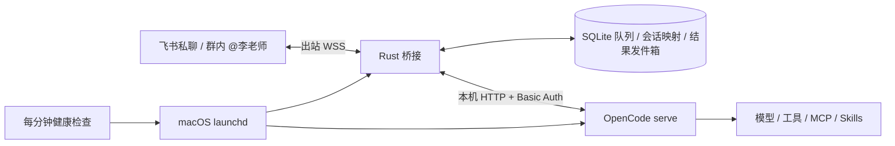

# 李老师（mr-li）

一个 Rust 常驻桥接服务：通过飞书接收消息，把执行交给 OpenCode，再把结果、授权请求和补充提问发回飞书。



## 为什么使用 HTTP，而不先接 ACP

OpenCode 自身提供 `opencode serve`，可以通过 HTTP 创建会话、提交任务、中止任务和处理权限/提问。桥接层用 `reqwest` 直接调用这些接口，无需额外的 JS SDK、Node、ACP JSON-RPC 客户端或终端模拟。ACP 更适合将来需要兼容多种 Agent/编辑器的场景；目前只接 OpenCode，HTTP 更直接。`opencode run --format json` 也可做一次性调用，但长期桥接还需要自行处理子进程、会话、授权和提问，因此当前选择常驻 HTTP 服务。

**本版只接入 OpenCode V2.3.x，已验证 macOS 12 兼容版 2.3.0**。使用 `/api/info`、`/api/model`、`/api/session` 等 V2 接口，不再运行独立的 V1。macOS 12 必须保留可运行的兼容启动器及其底层包，不能用普通官方二进制覆盖。

参考：[V2 API](https://opencode.ai/docs/api)、[飞书官方长连接实现](https://github.com/larksuite/oapi-sdk-python/blob/v2_main/lark_oapi/ws/client.py)。

## 当前支持

- 飞书企业自建应用 WebSocket：发现地址、Protobuf 帧、心跳、分片重组、ACK、断线退避重连；不需要公网端口。
- 应用 ID 默认 `cli_aa9b39cf2f789eef`，Secret 从部署机的 `.env` 读取。
- 支持飞书和 Lark 国际版（`FEISHU_DOMAIN=feishu` / `lark`）；可通过 `FEISHU_ALLOWED_CHAT_IDS` 限定群 ID。
- 用户 open_id 白名单；私聊直接接收，群聊必须 @当前机器人；过滤机器人消息。支持文字消息和模型选择卡片；图片、文件和音频尚未接入。
- 私聊按用户和聊天保留会话；群聊再按话题根消息隔离。不同用户不共享 OpenCode 会话，但共用配置的工作目录和文件。
- 默认全局只执行 **1 个模型任务**，其他消息进持久队列（上限 500）；指令和授权回复仍可处理。单线程 Tokio，避免为桥接创建大量工作线程。
- 消息先落 SQLite 再 ACK；按 message_id 去重（完成记录保留 30 天）。回复分片并记录进度，失败指数退避重试；UUID 减少飞书重试产生的重复回复。跨平台/跨进程不承诺端到端 exactly-once。
- 重启保留会话、未执行任务和结果发件箱；执行中的任务先请求中止并提示，不自动重跑。操作可能已发生，用户检查后再决定是否重发。
- `/models` 或“切换模型”打开交互卡片：下拉点选免费模型，按用户与聊天保存选择，跨话题及重启保留；不改变正在执行的任务。卡片只允许发起者在原聊天操作，回调幂等处理。
- `/approve` 只批准一次，并核对请求是否属于当前用户/聊天/话题对应的会话。不会自动批准所有工具。
- OpenCode 默认使用独立直连进程：清除该进程继承的大小写 HTTP/HTTPS/ALL_PROXY，设置 NO_PROXY=*；不修改系统代理。`MR_LI_DIRECT_NETWORK=false` 可显式恢复继承网络环境。桥接访问本机 OpenCode API 始终不走代理。
- 上游 429 只表示免费请求被限流或拒绝，不能直接当成账号额度耗尽；代理出口和不兼容的内核也可能触发拒绝。
- 任务默认 30 分钟超时并请求中止；同一数据目录只允许一个桥接进程。
- `launchd` 分别保护两个进程，退出后自动重启；独立 watchdog 检测 OpenCode HTTP 失联和桥接心跳停滞。

Rust 降低的是桥接进程的内存和启动开销。OpenCode、模型、MCP 与工具仍有各自开销；低配置机器建议使用远程模型，少开 MCP 服务。当前没有实测整机内存占用或模型任务延迟。

处理反馈沿用 `xiaoli/server` 的飞书逻辑：普通模型任务及 `/photo`、`/video` 开始执行时，随机在原消息添加 `Typing`、`OnIt`、`THINKING`、`OneSecond` 之一，回复全部送达后撤除。错误与停止结果回发后同样清理；表情记录持久保存，重启后继续清理，撤除失败每 30 秒重试。表情接口故障不阻止任务执行；需要 `im:message` 或 `im:message.reactions:write_only` 权限。快捷控制命令保持原有响应方式。

## 开发与验证

需要 Rust 1.88+、C 编译工具（macOS Command Line Tools）。SQLite 静态编译，不需要独立数据库服务。

```bash
cargo test --locked
cargo clippy --locked --all-targets -- -D warnings
./scripts/build-release.sh
```

产物：`dist/mr-li-Darwin-<架构>.tar.gz`，包括 Rust 二进制、脚本、示例配置和说明，不打包密钥/数据，也不打包 OpenCode。**编译产物架构应匹配目标机**；本机 Intel 编译的包不能当成 Apple Silicon 原生包。可在同架构机器构建，或把源码搬到目标 Mac mini 构建一次。

可选的真实 OpenCode 接口冒烟检查（仅开发测试需要 Python 3）：

```bash
python3 scripts/smoke-opencode.py /absolute/path/to/opencode
```

这个检查保留兼容启动器所需的 HOME，使用临时 XDG、数据库和工作目录，不连接飞书、不提交模型任务、不触碰日常 OpenCode 会话。它验证真实 V2 的健康、鉴权、会话、权限/表单和配置接口。

## Mac mini 首次部署

以下命令**在目标 Mac mini 执行**。开发电脑无需安装守护服务。

1. 解压构建包到固定目录，例如 `~/Services/mr-li`；或克隆完整源码。
2. 在**目标机的部署用户**下运行交互向导，不要 sudo 整个向导：

```bash
cd ~/Services/mr-li
./scripts/init.sh
```

向导会依次完成：

- 检查本机架构。有可用二进制就跳过编译环境；源码部署时检查 Apple Command Line Tools 和 Rust 1.88+，询问是否安装缺少的工具，再执行 `cargo build --locked --release`。Command Line Tools 的系统窗口安装完成后需重新运行向导。
- 隐藏输入飞书 App Secret；输入允许的用户 open_id、工作目录和模型名称；本地 OpenCode 服务密码可隐藏输入，也可回车生成随机密码。
- 检查 OpenCode V2.3.x 启动器路径。macOS 12 请选择已安装并验证过的兼容启动器；不自动下载替换内核，不安装 V1。
- 生成权限为 600 的 `.env`，创建工作目录；已有 `.env` 默认保留，已有工作目录 OpenCode 配置也保留。
- 默认使用 OpenCode 官方免费模型，任务前检查模型的输入和输出价格为零；免费额度不足或模型下线时返回错误，不自动切到付费模型。会话只提交到所选免费模型，使用显式会话标题，无需迁移开发机的账号配置。
- 最后选择开机运行、登录后运行或暂不安装服务。选择安装才会启动实际服务。

如只想填写配置，不下载、不编译、不认证或启动服务：

```bash
./scripts/init.sh --configure-only
```

也可以手动准备：复制 `.env.example` 为 `.env`，按注释填写，并将 `opencode.example.json` 复制到任务工作目录。OpenCode V2 的安装请参见[官方文档](https://opencode.ai/docs/)，macOS 12 需额外准备兼容包；[Rust 安装说明](https://rust-lang.org/install)提供 rustup 的官方流程。

示例 OpenCode 权限默认全部允许，适合本项目无人值守执行；桥接也会自动同意当前任务所属会话里挂起的操作权限请求，不再发送授权按钮或等待 `/approve`。可按实际需求在工作目录 `opencode.json` 中调整；配置使用 V2 的 `permissions` 规则数组和 `action/resource/effect` 字段。真正需要用户补充信息的提问仍通过 `/answer` 回答，操作授权和信息提问分别处理。

`MR_LI_WORKSPACE` 指向 Agent 的任务目录；请与服务安装目录分开。`.env` 使用 dotenv 语法，路径含空格时用引号；不要用 shell 表达式、`~` 或 `$HOME`，填写绝对路径。环境变量优先于 `.env`。

3. 在 [飞书应用后台](https://open.feishu.cn/app/cli_aa9b39cf2f789eef) 配置：

   - 启用机器人能力，配置应用可用范围。
   - 开通接收单聊消息 `im:message.p2p_msg:readonly`、接收群聊 @机器人消息 `im:message.group_at_msg:readonly`、以应用发送消息 `im:message:send_as_bot` 权限。
   - 事件与回调选择**使用长连接接收事件**，订阅 `im.message.receive_v1`，并发布生效版本。
   - 在独立的“回调配置”页选择**使用长连接接收回调**，订阅新版 `card.action.trigger`，用于模型选择卡片；不要选择旧版 `_v1`。消息事件订阅与卡片回调订阅需要分别配置。
   - 白名单填用户在这个应用下的 `open_id`（`ou_...`），不是 user_id、union_id 或邮箱。可以通过飞书 API 调试台查询。
   - 同一应用不要在多台机器同时运行此桥接；飞书多连接会分配事件，而不是广播全部消息。

4. 如果向导中暂不安装服务，可先前台检查，两个终端分别执行：

```bash
./scripts/run.sh check
./scripts/run.sh opencode
# 另一个终端：
./scripts/run.sh health
./scripts/run.sh bridge
```

`check` 仅验证本地配置。确认飞书收发、一次模型任务和一次权限请求后，退出前台两个进程，再安装常驻服务。

## 开机运行与进程保护

推荐需要无人登录也运行的 Mac mini 使用系统模式：

```bash
sudo ./scripts/service.sh install system
sudo ./scripts/service.sh status system
sudo ./scripts/service.sh restart system
# 停止并移出 launchd 加载目录，保留配置/日志/会话数据：
sudo ./scripts/service.sh uninstall system
```

请从**实际部署用户**运行 sudo。桥接与 OpenCode 通过 LaunchDaemon 的 `UserName` 以这个用户运行，使用其 HOME，不以 root 执行 Agent。仅系统 watchdog 的固定包装脚本安装为 root 所有；它始终先降权再检查用户服务，再以 root 请求 launchd 重启。

不需要登录前运行时，可以用用户模式，**无需 sudo**：

```bash
./scripts/service.sh install
./scripts/service.sh status
./scripts/service.sh restart
./scripts/service.sh uninstall
```

用户模式是 LaunchAgent，登录后启动，退出登录停止。系统和用户模式择一安装；更换模式前先卸载旧模式。`install` 会重新生成并加载 plist，升级二进制后用 `restart`。服务安装路径或部署用户变化后重新执行 `install`。

两个服务均配置 `KeepAlive`，重启节流 15 秒。watchdog 每 60 秒检查，OpenCode 连续 3 次健康失败触发重启；用户模式下桥接心跳超过 180 秒重启桥接，系统模式下探针连续 3 次失败会重启两者。故障检测不是即时的。重启 OpenCode 会中断正在执行的任务。launchd 无法让睡眠中的电脑继续工作；需要常驻时，在系统设置中调整睡眠和断电恢复。FileVault 下整机重启仍可能需要先解锁磁盘。

日志位于安装目录 `logs/`；SQLite 和心跳位于 `MR_LI_DATA_DIR`。目录默认仅当前用户可访问。日志当前不自动轮转，应定期检查大小。watchdog 不替代业务监控；配置错误、模型认证失效、飞书缺权限需要根据日志修正。

## 飞书指令

| 指令 | 作用 |
|---|---|
| 普通文字 | 在当前会话执行任务，忙时排队 |
| `/help` | 帮助 |
| `/posture` | 本地姿态模型试验：抓图、回传关键点图片、背面判断和分数说明，不调用 OpenCode |
| `/posture start [秒数]` | 启动定时采样，默认每 60 秒，支持 30–3600 秒；有明确结果时在 Mac mini 语音播报，飞书每 10 分钟汇总，不连续发送图片 |
| `/posture status`、`/posture stop` | 查询最近采样结果、停止定时试验 |
| `/photo` | 获取小米摄像头当前照片，直接回复图片 |
| `/video [秒数]` | 从现在录像并回复可播放的视频；默认 10 秒，支持 1–30 秒 |
| `/models`、`/model` 或“切换模型” | 打开免费模型下拉卡片，点选即切换 |
| `/status` | 当前会话、模型、执行和排队状态 |
| `/new` | 下条消息新建会话；旧会话保留。忙时先 `/stop` |
| `/stop` | 请求中止当前会话，取消它的排队任务 |
| `/approve <ID>` | 本次批准权限请求 |
| `/deny <ID>` | 拒绝权限请求或提问 |
| `/answer <ID> [["答案1"],["答案2"]]` | 按问题顺序提供二维字符串数组；多选放在同一个内层数组 |

群聊中，文字指令需要 @李老师。模型选择在你当前聊天的所有话题中生效；`/stop`、权限回复等会话操作请在发起任务的同一话题发送。卡片点选无需再 @机器人，卡片 30 分钟有效，转发后不可操作。当前结果以任务完成后的文本发送，权限/提问在执行过程中同步；没有 token 流式卡片、附件收发或过程工具日志展示。

## Homebridge 摄像头

支持 Homebridge 的 `homebridge-xiaomi-go2rtc` 插件，通过其本机 RTSP 流 `rtsp://127.0.0.1:<rtspPort>/xiaomi_<did>` 按需截图和录像。Homebridge 自身没有通用的摄像头 HTTP 接口，只有灯或仅支持摄像头开关的插件无法读取画面。

1. 在部署机的 Homebridge 安装 `homebridge-xiaomi-go2rtc`，并在 go2rtc 页面 **Add → Xiaomi** 连接米家账号。账号凭证由插件保存，不复制到桥接或 OpenCode 配置。给 go2rtc 的局域网页面设置密码；RTSP 保持仅监听 127.0.0.1。
2. 准备可在部署机运行的 FFmpeg，执行 `scripts/init-camera.sh`，填写实际 Homebridge 配置路径、摄像头 did 和 FFmpeg 路径。macOS 12 不能使用当前 `ffmpeg-for-homebridge` 的默认二进制；macOS 12 的部署使用上游 v2.1.0 兼容构建，安装后需在目标机验证 `ffmpeg -version` 和实际抓取。
3. 重启桥接后，在允许的飞书群里 @李老师 使用 `/photo`、`/video` 或 `/video 20`。应用需有 `im:resource` 或 `im:resource:upload` 媒体上传权限。

这两个命令直接执行，不调用模型。录像不读取 SD 卡历史，也不会常驻录制；每次等待首个 I 帧后才截图或开始计时，避免缺少参考帧导致灰屏，录像保留完整指定时长；一次只抓取一个摄像头任务，控制命令和模型任务可继续处理，`/stop` 可停止当前话题的摄像头任务。视频以单线程、最多 960 像素宽、10 fps 编码为 H.264 MP4，关闭音频，限制文件大小；上传使用文件流。成功或失败后清理临时媒体，飞书发送失败只重试已有媒体标识，不重新拍摄。

## 本地坐姿模型试验

这一阶段提供 `/posture` 单次试验，以及手动启动的定时采样。新安装默认关闭定时采样；启动后默认每 60 秒检查并在 Mac mini 扬声器播报当次结果，无异常也播报；无法判断时保持静音，仅写入每 10 分钟的飞书汇总（仍归为未知，不当作正常）。飞书每 10 分钟汇总检查次数、疑似低头/歪头次数、未触发次数及未知次数，并列出每分钟的记录时间（北京时间）及结果；不附照片，也不调用在线视觉模型，取消原先连续异常立即推送的逻辑。单次 `/posture` 返回当次判断和关键点图。模型分数不是“实际可见”或准确率，桌椅遮挡处也可能被模型猜出高分点。背面规则只使用双耳、双肩（均需分数 ≥0.5），不使用椅子遮住的髋部。以耳朵中心到肩线的投影距离除以肩宽得到头肩高度比：<0.42 返回 `needs_reminder`；0.42–0.50 返回 `unknown`；≥0.50 且未歪头返回 `no_obvious_issue`，也不等于确认合格坐姿。头线相对肩线倾斜 ≥18° 提示疑似歪头；这是二维启发式规则，不能解释为真实颈部角度。关键点缺失、转头导致双耳重叠、头肩不匹配均返回 `unknown`，静音并计入未知次数。已根据同一机位的一张低头样本（高度比约 0.31）和一张用户确认较直的样本（原始检测记录约 0.54）校准范围；这两张是校准样本，不是独立准确率验证。带关键点的回传截图会干扰再次推理，因此以相应原始帧的检测记录为准。

- 模型：MoveNet SinglePose Thunder，使用 [Xenova 的 ONNX 导出](https://huggingface.co/Xenova/movenet-singlepose-thunder)，固定 revision `bf87836467d0c9988f3d76b96b2fe9f4262b0394`，Apache-2.0，SHA-256 在 `scripts/setup-pose.sh` 中固定。
- 运行时：独立 Rust 程序 `mr-li-pose`，调用 ONNX Runtime 1.18.0 的单线程 CPU 推理；桥接默认构建不依赖推理运行时。无需 Python、外部模型账号或在线推理请求。
- 在开发电脑构建包含姿态程序的包：`MR_LI_BUILD_POSE=1 ./scripts/build-release.sh`。目标机运行 `scripts/setup-pose.sh` 下载并校验模型与 macOS 11+ 的 Intel CPU 运行库；也可在包的 `models/movenet-thunder.onnx` 放入相同权重以离线安装。
- `.env` 可配置 `MR_LI_POSTURE_SPEECH`（默认 true）、`MR_LI_POSTURE_VOICE`（默认 Ting-Ting）、`MR_LI_POSTURE_AUDIO_DEVICE`（默认 Built-in Output），使用 macOS 自带 `/usr/bin/say`，不修改系统音量。模型相关配置为 `MR_LI_POSE_BIN`、`MR_LI_POSE_MODEL`、`MR_LI_POSE_ROI`。ROI 为 `x,y,width,height` 四个 0–1 比例；空值使用全图。调整后重启桥接。只裁剪分析区域，关键点仍映射回原图坐标。

离线试验示例：

```bash
cargo build --locked --release --features pose --bin mr-li-pose
target/release/mr-li-pose --model .data/pose-models/movenet-thunder.onnx \
  --image photo.jpg --output artifacts/posture/sample --repeat 5 \
  --roi 0.08,0.4,0.42,0.6
```

输出 `.png` 关键点图片、`.json` 原始关键点/模型分数/耗时、可独立打开的 `.html` 报告。绿色点及骨架分数 ≥ 0.5，橙色点为 0.35–0.5，更低分或落在裁剪区域外的点不绘制、不参与测量。姿态程序只能在头部点足够时输出二维头部连线角度，不能将该值直接解释成真实颈部角度。飞书试验完成后清理临时照片与报告。

定时设置与最近采样说明保存在 SQLite，服务重启后恢复；不补跑离线期间的采样，不积压同类任务。`/posture stop` 或 `/stop` 可停止本聊天的采样。后台采样不调用在线模型服务、不上传照片到飞书；每 10 分钟只发送文字汇总。采样次数不代表持续时长，未知不并入正常计数。采样失败和语音失败也会记录并进入汇总；采样与汇总是独立计时器。汇总计时、计数与逐次文字记录保存在 SQLite，重启后恢复，不补发离线期间的一串汇总；尚未送达的同一汇总不重复排队。文字明细随汇总写入可靠发送队列后清理，失败重试复用同一份文字，不重新抓图。正常每批约 10 条明细；如果长期发送失败，汇总保留完整计数、仅展开最近 60 条并注明省略数量。临时图像处理完即清理，播报进程支持取消与 20 秒超时。停止监测会停止在播语音并取消尚未发送的后台汇总。

之前的 Lightning 在用户低头样本上仅有 1 个高分点；换成 Thunder 并裁剪书桌区域后，双耳、双肩均达到阈值，头肩高度比约 0.31，返回疑似低头过多。改变裁剪范围的另两次试验得到 0.26、0.30，同样触发。这仅是同一张照片的鲁棒性检查，不是三个独立验证样本。 Mac mini（i5-4260U、4 GB、macOS 12.7.6）原生 Thunder 实测 10 次推理中位数约 97 ms，加载约 197 ms，峰值 RSS 78.5 MiB。

## 联调状态

摄像头：已在 Mac mini 验证米家登录、设备发现、真实照片和完整 10 秒 H.264 视频（864×480、10 fps，约 400 KB），并通过真实飞书图片上传检查。群内两个命令均成功回发；首帧灰屏问题已修复并部署，用户已确认照片、视频封面与视频开头均正常，端到端验收通过。

2026-11-15 已在 Intel Mac mini（macOS 12.7.6）安装用户 LaunchAgent，验证 Lark 国际版长连接、群内 `/help` 往返、模型卡片展开/点选/原卡更新、选择持久保存及进程退出后的自动重启。执行模型限于 OpenCode 官方免费模型，没有保留开发机模型账号。已定位并修复 V1 接入与原生 V2 后台继承代理导致的 429 差异，兼容版 V2 直连的 CLI 和 HTTP 均成功返回免费模型文本，已部署的桥接专用服务也通过 MiMo 免费模型实测。群聊普通任务已完成端到端验收：MiMo 返回文本与飞书实收一致，任务状态 done、成功回发一次。整机重启及系统 LaunchDaemon 模式尚未在目标机验证。

首次部署不知道用户 open_id 时，可用只读身份识别模式：

```bash
./scripts/run.sh enroll oc_目标群ID 一次性确认短语123
```

让目标用户在该群发送包含这段短语的文字。此模式最长运行 10 分钟，只输出匹配消息的用户 open_id，不执行任务、不自动添加白名单；识别后将 ID 写入 `FEISHU_ALLOWED_OPEN_IDS` 并停止该进程，再启动正式服务。若要从私聊识别，把群 ID 改为 `p2p`。

V1 升级到 V2 时，旧会话映射会一次性归档到本地 `legacy_sessions` 表，新的任务创建 V2 会话。用户与聊天的模型选择、卡片和任务记录保留；不把 V1 的会话 ID 直接当作 V2 会话继续执行。
