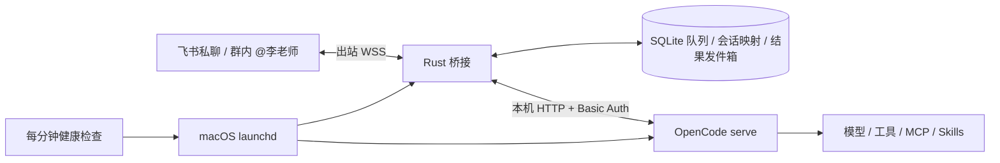

# 李老师（mr-li）

一个 Rust 常驻桥接服务：通过飞书接收消息，把执行交给 OpenCode，再把结果、授权请求和补充提问发回飞书。



## 为什么使用 HTTP，而不先接 ACP

OpenCode 自身提供 `opencode serve`，可以通过 HTTP 创建会话、提交任务、中止任务和处理权限/提问。桥接层用 `reqwest` 直接调用这些接口，无需额外的 JS SDK、Node、ACP JSON-RPC 客户端或终端模拟。ACP 更适合将来需要兼容多种 Agent/编辑器的场景；目前只接 OpenCode，HTTP 更直接。`opencode run --format json` 也可做一次性调用，但长期桥接还需要自行处理子进程、会话、授权和提问，因此当前选择常驻 HTTP 服务。

**本版明确适配 OpenCode 1.19.0（V1 API）**。OpenCode 最新文档已进入 V2，接口发生变化；服务会拒绝不匹配的版本，避免升级后静默失败。这里的 V1 指 OpenCode 的产品/API 代际。

参考：[V1 Server](https://opencode.ai/v1/docs/server/)、[V1 SDK](https://opencode.ai/v1/docs/sdk/)、[当前 V2 API](https://opencode.ai/docs/api)、[飞书官方长连接实现](https://github.com/larksuite/oapi-sdk-python/blob/v2_main/lark_oapi/ws/client.py)。

## 当前支持

- 飞书企业自建应用 WebSocket：发现地址、Protobuf 帧、心跳、分片重组、ACK、断线退避重连；不需要公网端口。
- 应用 ID 默认 `cli_aa9b39cf2f789eef`，Secret 从部署机的 `.env` 读取。
- 用户 open_id 白名单；私聊直接接收，群聊必须 @当前机器人；过滤机器人消息。当前只处理文字，图片、文件、音频和卡片交互尚未接入。
- 私聊按用户和聊天保留会话；群聊再按话题根消息隔离。不同用户不共享 OpenCode 会话，但共用配置的工作目录和文件。
- 默认全局只执行 **1 个模型任务**，其他消息进持久队列（上限 500）；指令和授权回复仍可处理。单线程 Tokio，避免为桥接创建大量工作线程。
- 消息先落 SQLite 再 ACK；按 message_id 去重（完成记录保留 30 天）。回复分片并记录进度，失败指数退避重试；UUID 减少飞书重试产生的重复回复。跨平台/跨进程不承诺端到端 exactly-once。
- 重启保留会话、未执行任务和结果发件箱；执行中的任务先请求中止并提示，不自动重跑。操作可能已发生，用户检查后再决定是否重发。
- `/approve` 只批准一次，并核对请求是否属于当前用户/聊天/话题对应的会话。不会自动批准所有工具。
- 任务默认 30 分钟超时并请求中止；同一数据目录只允许一个桥接进程。
- `launchd` 分别保护两个进程，退出后自动重启；独立 watchdog 检测 OpenCode HTTP 失联和桥接心跳停滞。

Rust 降低的是桥接进程的内存和启动开销。OpenCode、模型、MCP 与工具仍有各自开销；低配置机器建议使用远程模型，少开 MCP 服务。当前没有实测整机内存占用或模型任务延迟。

## 开发与验证

需要 Rust 1.88+、C 编译工具（macOS Command Line Tools）。SQLite 静态编译，不需要独立数据库服务。

```bash
cargo test --locked
cargo clippy --locked --all-targets -- -D warnings
./scripts/build-release.sh
```

产物：`dist/mr-li-Darwin-<架构>.tar.gz`，包括 Rust 二进制、脚本、示例配置和说明，不打包密钥/数据，也不打包 OpenCode。**编译产物架构应匹配目标机**；本机 Intel 编译的包不能当成 Apple Silicon 原生包。可在同架构机器构建，或把源码搬到目标 Mac mini 构建一次。

可选的真实 OpenCode 接口冒烟检查（仅开发测试需要 Python 3）：

```bash
python3 scripts/smoke-opencode.py /absolute/path/to/opencode
```

这个检查使用临时 HOME/XDG 和工作目录，不连接飞书、不提交模型任务、不触碰日常 OpenCode 会话。它验证真实 1.19.0 的健康、鉴权、会话、权限/提问列表和配置接口；模型执行仍需部署机联调。

## Mac mini 首次部署

以下命令**在目标 Mac mini 执行**。开发电脑无需安装守护服务。

1. 解压构建包到固定目录，例如 `~/Services/mr-li`；或克隆完整源码。
2. 在**目标机的部署用户**下运行交互向导，不要 sudo 整个向导：

```bash
cd ~/Services/mr-li
./scripts/init.sh
```

向导会依次完成：

- 检查本机架构。有可用二进制就跳过编译环境；源码部署时检查 Apple Command Line Tools 和 Rust 1.88+，询问是否安装缺少的工具，再执行 `cargo build --locked --release`。Command Line Tools 的系统窗口安装完成后需重新运行向导。
- 隐藏输入飞书 App Secret；输入允许的用户 open_id、工作目录和模型名称；本地 OpenCode 服务密码可隐藏输入，也可回车生成随机密码。
- 检查 OpenCode 1.19.0，缺失或版本不符时可下载官方对应架构版本并校验固定 SHA-256。下载到服务目录的 `bin/`，不替换系统中的其他版本。
- 生成权限为 600 的 `.env`，创建工作目录；已有 `.env` 默认保留，已有工作目录 OpenCode 配置也保留。
- 可运行 `opencode auth login` 原生模型认证向导，输入供应商 API Key 或登录。模型凭证由 OpenCode 管理，不写入桥接 `.env`。
- 最后选择开机运行、登录后运行或暂不安装服务。选择安装才会启动实际服务。

如只想填写配置，不下载、不编译、不认证或启动服务：

```bash
./scripts/init.sh --configure-only
```

也可以手动准备：复制 `.env.example` 为 `.env`，按注释填写，并将 `opencode.example.json` 复制到任务工作目录。OpenCode 可从官方 [1.19.0 发布资源](https://github.com/anomalyco/opencode/releases/tag/v1.19.0)安装；[Rust 安装说明](https://rust-lang.org/install)提供 rustup 的官方流程。

示例 OpenCode 权限允许常规读取和提问，其他工具请求授权。可按实际需求在工作目录 `opencode.json` 中调整；配置使用 1.19.0 的 `permission` 字段。`question: allow` 使 Agent 能发起提问，答案仍由用户在飞书提供。

`MR_LI_WORKSPACE` 指向 Agent 的任务目录；请与服务安装目录分开。`.env` 使用 dotenv 语法，路径含空格时用引号；不要用 shell 表达式、`~` 或 `$HOME`，填写绝对路径。环境变量优先于 `.env`。

3. 在 [飞书应用后台](https://open.feishu.cn/app/cli_aa9b39cf2f789eef) 配置：

   - 启用机器人能力，配置应用可用范围。
   - 开通接收单聊消息 `im:message.p2p_msg:readonly`、接收群聊 @机器人消息 `im:message.group_at_msg:readonly`、以应用发送消息 `im:message:send_as_bot` 权限。
   - 事件与回调选择**使用长连接接收事件**，订阅 `im.message.receive_v1`，并发布生效版本。
   - 白名单填用户在这个应用下的 `open_id`（`ou_...`），不是 user_id、union_id 或邮箱。可以通过飞书 API 调试台查询。
   - 同一应用不要在多台机器同时运行此桥接；飞书多连接会分配事件，而不是广播全部消息。

4. 如果向导中暂不安装服务，可先前台检查，两个终端分别执行：

```bash
./scripts/run.sh check
./scripts/run.sh opencode
# 另一个终端：
./scripts/run.sh health
./scripts/run.sh bridge
```

`check` 仅验证本地配置。确认飞书收发、一次模型任务和一次权限请求后，退出前台两个进程，再安装常驻服务。

## 开机运行与进程保护

推荐需要无人登录也运行的 Mac mini 使用系统模式：

```bash
sudo ./scripts/service.sh install system
sudo ./scripts/service.sh status system
sudo ./scripts/service.sh restart system
# 停止并移出 launchd 加载目录，保留配置/日志/会话数据：
sudo ./scripts/service.sh uninstall system
```

请从**实际部署用户**运行 sudo。桥接与 OpenCode 通过 LaunchDaemon 的 `UserName` 以这个用户运行，使用其 HOME 和模型认证，不以 root 执行 Agent。仅系统 watchdog 的固定包装脚本安装为 root 所有；它始终先降权再检查用户服务，再以 root 请求 launchd 重启。

不需要登录前运行时，可以用用户模式，**无需 sudo**：

```bash
./scripts/service.sh install
./scripts/service.sh status
./scripts/service.sh restart
./scripts/service.sh uninstall
```

用户模式是 LaunchAgent，登录后启动，退出登录停止。系统和用户模式择一安装；更换模式前先卸载旧模式。`install` 会重新生成并加载 plist，升级二进制后用 `restart`。服务安装路径或部署用户变化后重新执行 `install`。

两个服务均配置 `KeepAlive`，重启节流 15 秒。watchdog 每 60 秒检查，OpenCode 连续 3 次健康失败触发重启；用户模式下桥接心跳超过 180 秒重启桥接，系统模式下探针连续 3 次失败会重启两者。故障检测不是即时的。重启 OpenCode 会中断正在执行的任务。launchd 无法让睡眠中的电脑继续工作；需要常驻时，在系统设置中调整睡眠和断电恢复。FileVault 下整机重启仍可能需要先解锁磁盘。

日志位于安装目录 `logs/`；SQLite 和心跳位于 `MR_LI_DATA_DIR`。目录默认仅当前用户可访问。日志当前不自动轮转，应定期检查大小。watchdog 不替代业务监控；配置错误、模型认证失效、飞书缺权限需要根据日志修正。

## 飞书指令

| 指令 | 作用 |
|---|---|
| 普通文字 | 在当前会话执行任务，忙时排队 |
| `/help` | 帮助 |
| `/status` | 当前会话、执行和排队状态 |
| `/new` | 下条消息新建会话；旧会话保留。忙时先 `/stop` |
| `/stop` | 请求中止当前会话，取消它的排队任务 |
| `/approve <ID>` | 本次批准权限请求 |
| `/deny <ID>` | 拒绝权限请求或提问 |
| `/answer <ID> [["答案1"],["答案2"]]` | 按问题顺序提供二维字符串数组；多选放在同一个内层数组 |

群聊中，指令也需要 @李老师，并在发起任务的同一话题回复。当前结果以任务完成后的文本发送，权限/提问在执行过程中同步；没有 token 流式卡片、附件收发或过程工具日志展示。

## 联调状态

本地测试不能替代目标机验证。交付包含单元测试、真实 OpenCode API 冒烟脚本和可构建部署包；尚未使用真实 App Secret 连接飞书，也未在目标 Mac mini 安装、重启或断网测试。部署后应确认文字往返、连续上下文、群 @过滤、授权/提问、停止和系统重启恢复。
