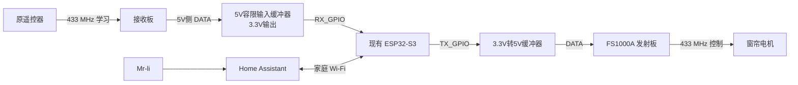

# LONGSAM 窗帘 RF 收发方案

## 手头硬件与目标

用户提供的商品图包含两块模块：长条板为 433.92 MHz 超再生接收板，常见于
MX-05V/MX-RM-5V 套件；方形板丝印 FS1000A，商品参数称 MX-FS-03V 发射模块。
具体接收板型号、针脚顺序和电平仍以用户实物为准。目标是沿用现有 ESP32-S3，
学习原 LONGSAM 遥控器的升、降、停，然后通过 HA/Mr-li 调用。

商品图不是可靠的逐针接线图：

- 接收板有两处“5V电源”箭头，没有清楚区分正极与地；不能把两端都接 +5V。
- 发射板 DATA 是基带信号输入，图中“信号输出”易误解；接收板 DATA 则是输出。
- 常见接收板两根 DATA 可能并联，只有核实型号/通断后才能认定。
- 根据原 S3CAM 配置，已确定 TX=GPIO21、RX=GPIO47；先移除旧屏幕在这两脚的跳线。
  引脚编号指丝印 GPIO，不是排针的物理序号。

## 接线设计

两块 RF 模块先统一用稳定的 **5V** 电源，与 ESP32 共地。5V 可来自确认可用的
开发板 VBUS/5V 引脚或同一 USB 电源的分配端；GPIO 只提供信号，不给模块供电。
不要按发射模块允许 12V 就将接收板也接 12V。接收板商品规格为 DC5V。

推荐的电平适配为两条单向链路：

| 路径 | 连接 |
|---|---|
| 接收 DATA → ESP32 | `SN74LVC1G17` 的 A 接接收 DATA，芯片 VCC 接 3.3V，Y 接 RX_GPIO |
| ESP32 → 发射 DATA | `SN74AHCT125` 用一个通道，VCC 接 5V，A 接 TX_GPIO，Y 接发射 DATA，/OE 接 GND |
| 发射默认关闭 | TX_GPIO/缓冲器输入 A 加约 10kΩ 下拉；固件空闲输出低电平 |
| 所有地 | RF 板、两颗缓冲器、ESP32 GND 共地 |

SN74LVC1G17 输入允许到 5.5V，3.3V 供电时输出为 3.3V 逻辑，还带施密特整形。
AHCT125 在 5V 供电时采用 TTL 输入门限，可将 ESP32 的 3.3V 信号转换为 5V 驱动。
这两个器件的用途和供电不同，不能互换。可使用已焊接的转接板；未用 AHCT 通道的
输入和使能端按数据手册固定，不能悬空。

本套模块 DATA 的具体高电平/门限未提供，所以不把“接收 DATA 直连 GPIO”或
“发射一定能被 3.3V 直接驱动”作为已验证条件。若采用电阻分压，需要先确认接收
DATA 的实际高电平及 ESP32 VIH 裕量；分压比不能只按模块 5V 供电推算。

每块 RF 模块旁加 100nF 去耦，并在 5V 分配处放 10–47µF 电容；缓冲器电源旁同样
放 100nF。发射板和接收板的 ANT 各接约 **17.3cm 直线导线**作为 433.92MHz 四分之一
波长天线，初测尽量伸直。弯折/绕线天线是另一种结构，不照搬商品图中不同长度的说法。
接收板远离 ESP32 天线、电源噪声源；初测原遥控器距离约 0.5–1m，避免贴脸过载。

## 分阶段验证

1. **只接接收链路。** 核实 VCC/GND、接收 DATA 输出、电平转换和 GPIO 后再采集。
   学习期间发射端保持低电平或暂不连接，避免把自身发射当成遥控信号。
2. **每个按键独立短按至少 5 次。** 只用正常升、降、停，不操作 P2/设置/限位键。
   ESP32 RMT RX 记录高低脉宽、同步间隔和重复帧；保存原始采样到本机分析。
3. **确认协议。** 先试 rc-switch 已支持的固定码；无法解码时分析原始 OOK 波形。
   超再生接收板无信号时也可能输出杂波，要按窗口、重复帧一致性和真实脉宽滤噪。
   多次按键的数据变化可能来自计数器/校验/通道，不能直接断定为滚动码。
4. **固定码才试重放。** 先验证停止码，再在合适位置短时升/降并立即停止；不更改
   电机已有行程和配对。停止是发送遥控器的 STOP 命令，不是切断射频模块电源。
5. **反复交叉验证。** 检查原遥控器与 ESP32 交替操作、板子重启后、不同距离下是否
   仍有效。只凭收到一帧或一次偶然动作，不能宣布兼容。
6. **再接 HA/Mr-li。** 验证三种动作稳定后，才提供日常自动化入口。

LONGSAM 官方 LM25A 的资料标 433.925MHz，与本套件标称 433.92MHz 接近，但它只是
品牌内一个型号；不能据此认定用户的电机、遥控器调制或编码完全相同。若遥控器采用
不兼容调制、其他频点或滚动码，原始 OOK 重放方案不适用。

若采样困难，先排查电平、天线和杂波，再考虑超外差接收器或可配置收发器。
更换接收器不会自动解决滚动码。确认需要滚动码时，选择实现已知协议并按电机规范
配对独立遥控身份，或改用一只备用原遥控器，通过隔离干接点模拟三个按键。
在协议不明时不盲目递增计数、发猜测码或操作清码/限位设置。

## 软件实施范围

`curtain.cc` 已扩展为接收学习与固定码 OOK 发送，保留 STOP 优先调度。当前 S3 已保存
TX21/RX47，发射默认禁用，尚没有实物学习数据。BLE 开机和 Wi-Fi 配置已保留。

本次实施范围：

- RMT RX 学习窗口、原始采样导出、帧切分、重复帧比对及必要的协议解码。
- 每键保存经过验证的波形及协议元数据，独立 NVS 命名空间，升级不覆盖 BLE token。
- 报文长度以采样结果为准：当前发射器限制 128 个脉宽、每个不超过 32767µs、
  配置 JSON/NVS 上限约 4KB。若真实协议超过限制，要同步调整发送/持久化/USB 边界，
  或按动作分别保存；不能截短遥控波形来满足旧限制。
- 复用现有 Bearer 认证的 Wi-Fi HTTP，增加 `curtain.status/up/down/stop` 路由。
  学习与配置初版走 USB 调试，日常控制独立走 Wi-Fi。发送时停止接收学习，避免自收。
- HA 提供 `cover.open_cover / close_cover / stop_cover`；升/降与开/关的对应关系用
  现场动作确认，可配置反向。未安装位置反馈时不声明百分比定位能力，不伪造当前百分比。
- **Mr-li 接入注意：** 原通用 HA 控制拒绝 `unknown` 和 `unavailable` 状态。
  无位置反馈的 cover 正常可能是 unknown。现已允许已发现且确有控制服务的无反馈实体操作，
  保留 unavailable/实体缺失的拒绝和原有目标/参数校验，回归测试已通过。
  这样可以通过现有 `ha_devices / ha_commands / ha_control` 接入，不需要新增 ESP32 MCP。
- 发射结果保持 `physical_effect_confirmed: false`。STOP 可抢占后续方向帧，但仍是无线
  尽力控制，不能将“码发完”当作电机已停或已到位置的回执。

设计后已实现接收学习与 Wi-Fi/HA 接口并进行 S3 烧录；代码状态和逐线接法见
[RF433.md](RF433.md)、[RF433_WIRING.md](RF433_WIRING.md)。RF 模块接线、真实遥控码
学习及电机动作仍待现场完成。
下一步按逐线接法连接硬件，再学习原遥控器并现场验证三种动作；商品图误标处
仍须按实物 VCC/GND/DATA 丝印核对，不能按照片左右顺序猜。

## 参考资料

- [MX-05V/MX-FS-03V 模块资料](https://www.mantech.co.za/Datasheets/Products/MX-XXX-240417A.pdf)
- [LONGSAM LM25A 官方说明书](https://www.langsenjd.com/wp-content/uploads/2026/01/2026012802003733.pdf)
- [TI SN74LVC1G17](https://www.ti.com/lit/ds/symlink/sn74lvc1g17.pdf)
- [TI SN74AHCT125](https://www.ti.com/lit/ds/symlink/sn74ahct125.pdf)
- [ESP32-S3 数据手册](https://documentation.espressif.com/esp32-s3_datasheet_en.pdf)
- [rc-switch](https://github.com/sui77/rc-switch)
